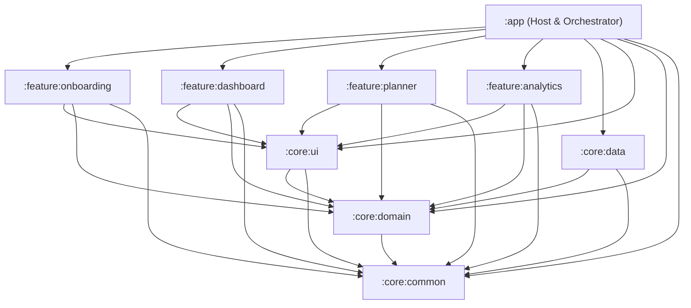

# SubCycler Architecture & Modularization 🏛️

This document outlines the architecture, design principles, module separation, and SOLID implementation for **SubCycler (SubTrack)**.

---

## 1. Architectural Principles & Patterns

The application follows the official **Google Recommended Architecture Guide for Android**, enforcing **Clean Architecture** and strict **SOLID principles**:

- **Single Responsibility Principle (SRP)**: Feature modules handle UI state and user intents; Use Cases encapsulate discrete domain business rules; Repositories manage data retrieval/persistence; Workers handle background evaluation.
- **Open/Closed Principle (OCP)**: Systems are extensible via interfaces (e.g. `TimeProvider`, `SubscriptionRepository`, `UserPreferencesRepository`) without modifying caller code.
- **Liskov Substitution Principle (LSP)**: Interface implementations (e.g., `FakeTimeProvider`, `FakeSubscriptionRepository`, `FakeUserPreferencesRepository`) substitute seamlessly in tests without affecting domain logic.
- **Interface Segregation Principle (ISP)**: Granular, focused use cases (`GetSubscriptionCycleStatusesUseCase`, `GetPortfolioSummaryUseCase`, `AlignPairedSubscriptionsUseCase`, `ManageSubscriptionUseCase`) instead of monolithic God-classes.
- **Dependency Inversion Principle (DIP)**: High-level business logic depends on domain abstractions, not concrete Room DAOs or system APIs. Injected via **Hilt (Dagger)**.

---

## 2. Multi-Module Project Hierarchy

```
SubCycler
 ├── :core:common       (Dispatchers qualifiers, TimeProvider abstractions, MoneyFormatter, testing fakes)
 ├── :core:domain       (Pure business logic, Domain models, RotationEngine, RegionalPriceCatalog, SubscriptionBackupCodec, Use Cases, Repository interfaces)
 ├── :core:data         (Room Database v5 + Migrations, DataStore Preferences, Repository implementations, Mappers, Calendar awareness, Hilt DI)
 ├── :core:ui           (Botanical Emerald M3 Expressive design system, OFL variable typography, Shapes, Auto-saving Multi-Step Form, Cycle Strategy Studio, Shared Cards & Timeline views)
 ├── :feature:onboarding (First-launch Welcome + App Currency picker, Service Stack picker, Regional tier review, Atomic batch import)
 ├── :feature:dashboard (Dashboard Route, Screen, ViewModel, Auto-save, Incomplete setup, Offline JSON/CSV backup & Settings)
 ├── :feature:planner   (Consolidated 45-day Cycle Timeline, Date Inspector & 30d/30d Paired Swap Baton-Pass visualizer)
 ├── :feature:analytics (Compounding 1Y/3Y/5Y ROI curve, Earned vs Projected Savings & Per-service Breakdown)
 └── :app               (Application class, MainActivity, 3-tab Split Floating Toolbar NavHost, WorkManager, Inexact Alarms, Deduplicated Reminders, Action Receivers & Home Widget)
```



---

## 3. Module Breakdown

### A. `:core:common` (`com.subtrack.core.common`)
- **Coroutines Dispatchers**: `@IoDispatcher`, `@DefaultDispatcher`, `@MainDispatcher` qualifiers and Hilt module.
- **Time Abstraction (`TimeProvider`)**: System clock wrapper (`DefaultTimeProvider`) and test double (`FakeTimeProvider`) for deterministic unit tests.
- **Currency Formatting (`MoneyFormatter`)**: Locale-aware currency symbol, decimal precision, and zero-decimal (`JPY`, `KRW`) formatting with zero network dependency.

### B. `:core:domain` (`com.subtrack.core.domain`)
- **Pure Kotlin**: Free of Android SDK references (`android.*`), allowing rapid local JVM unit testing (<20ms).
- **Domain Models**: `Subscription` (with `BillingPeriod`, `SetupMissingItem`, progressive `isIncomplete` state, `isBillingDateConfirmed`, `isStrategyConfirmed`, `bonusActiveDays`, and earned savings fields), `CycleStatus`, `NextAction`, `PortfolioSummary`, `SubscriptionPreset`, `RegionalPriceCatalog`, `PendingSubscriptionAction`, `UserPreferences`.
- **Backup Codec**: `SubscriptionBackupCodec` for deterministic offline JSON and CSV export/import.
- **Domain Use Cases**:
  - `GetSubscriptionCycleStatusesUseCase`: Evaluates active/blackout cycle phases, skips incomplete drafts from active alerts, and computes next actions.
  - `GetPortfolioSummaryUseCase`: Computes aggregate monthly/annual costs (normalizing yearly plans), earned vs. projected savings, and compounding multi-year ROI.
  - `AlignPairedSubscriptionsUseCase`: Synchronizes two paired subscriptions (e.g., Netflix + Disney+) to alternate 30d/30d without service blackout overlap.
  - `ManageSubscriptionUseCase`: Handles subscription CRUD (returning persisted row IDs for race-free auto-save), subscribe/unsubscribe action completions, break skipping, single app-wide currency unification (`updateAllSubscriptionsCurrency`), and reminder rescheduling hooks.
  - `GetCalendarAwareSuggestionsUseCase`: Evaluates optional local calendar occurrences against active subscriptions.
- **Domain Repositories**: `SubscriptionRepository`, `UserPreferencesRepository`, `CalendarAwarenessRepository`, `SubscriptionActionNotifier`, and `SubscriptionReminderScheduler` interfaces.

### C. `:core:data` (`com.subtrack.core.data`)
- **Room Persistence**: `AppDatabase` (version 5 with non-destructive `MIGRATION_1_2` through `MIGRATION_4_5`), `SubscriptionDao`, `SubscriptionEntity`, `Converters`.
- **Data Mappers**: Bidirectional conversion between `SubscriptionEntity` and domain `Subscription`.
- **DataStore Preferences**: `UserPreferencesRepositoryImpl` providing non-blocking `Flow<UserPreferences>` (theme mode, single app currency, reminder lead days, onboarding flag, calendar awareness config, and persistent `PendingSubscriptionAction`).
- **Repository Implementations**: `SubscriptionRepositoryImpl` (Room on `@IoDispatcher`) and `CalendarAwarenessRepositoryImpl` (local Android `CalendarContract`, opt-in only).
- **Hilt Dependency Injection**: `DataModule` and `UseCaseModule`.

### D. `:core:ui` (`com.subtrack.core.ui`)
- **Theme & Design System (`DESIGN.md` v3.5.0)**: `SubTrackTheme`, adaptive Light & Dark 70/30 Botanical Emerald tokens (`Color.kt`, `Theme.kt`), bundled offline OFL variable fonts (`Bricolage Grotesque` + `Plus Jakarta Sans` in `Type.kt` / `ExpressiveTypography.kt`), and masked silk-waves backdrop (`ExpressiveBackdrop.kt`).
- **Expressive Primitives**: `ExpressiveShapes.kt` (`ExpressiveCookie12Shape`, `ExpressiveSegmentedGroup`, `CycleRhythmTrack`, `WavyProgressIndicator`, diagonal hatch patterns), `AnimatedExpressiveIcons.kt`.
- **Reusable Components**: `FinancialEfficiencyHud`, `SubscriptionGridItem`, `SubscriptionDetailBottomSheet`, `AddEditSubscriptionDialog` (auto-saving 3-step swipe-locked sheet), `InteractiveCycleStrategyPicker`, `CycleTimelineView`, `NextActionBanner`, `CalendarAwarenessComponents` (consolidated offline Settings + App Currency manual-conversion warning), `CurrencyPickerDialog`, `CancellationOptionsDialog`, `PendingSubscriptionActionDialog`.

### E. Feature Modules (`:feature:*`)
- **`:feature:onboarding`**: First-launch Welcome screen with upfront App Currency selection, searchable Service Stack picker, regional 1-tap price tier confirmation, and atomic Starter Plan import.
- **`:feature:dashboard`**: Primary 2-column Bento dashboard with Hero HUD, filter/sort pills, Incomplete setup recovery, auto-save orchestration, undo-delete snackbar, Settings sheet, and offline JSON/CSV backup & restore.
- **`:feature:planner`**: Consolidated planning hub uniting the proportional multi-month **Cycle Timeline** + sliding Date Inspector and the 30d/30d **Paired Swap** Baton-Pass synchronizer (retiring the standalone `:feature:rotator` module).
- **`:feature:analytics`**: Editorial Savings dashboard with `1Y → 3Y → 5Y` compounding growth curve, stepped horizon bars, earned savings ledger, per-service **Savings Breakdown**, and direct Paired Swap shortcut.
- **MVI / UDF**: Stateful `*Route` + Stateless `*Screen` + `*ViewModel` with immutable `UiState` and sealed `UiAction`.

### F. `:app` (`com.subtrack.app`)
- **Host Application**: `SubTrackApplication` with on-demand `HiltWorkerFactory` configuration.
- **Navigation**: `SubTrackNavHost` with 3-tab Split Floating Pill Toolbar (`Subscriptions`, `Planner`, `Savings`), detached 12-petal scalloped `+` button, `AppViewModel`, and type-safe destinations (`Screen.kt`).
- **Background, Reminders & Broadcast**: `DailyCycleEvaluationWorker`, `WorkSchedulerManager`, `AlarmScheduler` (inexact alarms, zero `USE_EXACT_ALARM`), `AndroidSubscriptionReminderScheduler`, `ReminderDeduplicator`, `AndroidSubscriptionActionNotifier`, `BootReceiver`, `SubscriptionAlarmReceiver`, `SubscriptionActionReceiver`, `NotificationHelper`.
- **Home Screen Widget**: `SubCyclerWidgetProvider` + adaptive Light/Dark widget layouts (`widget_subcycler.xml`).

---

## 4. Testing & Verification

The architecture supports fast local JVM testing across every layer plus targeted Android instrumentation tests:
- **`:core:common` Unit Tests**:
  - `MoneyFormatterTest`: Verifies localized currency formatting and zero-decimal rules.
- **`:core:domain` Unit Tests**:
  - `RotationEngineTest`: Verifies rotation mathematical cycles, yearly normalization, `bonusActiveDays`, incomplete guards, and compounding ROI.
  - `GetSubscriptionCycleStatusesUseCaseTest`: Verifies stream status calculation.
  - `AlignPairedSubscriptionsUseCaseTest`: Verifies paired schedule alignment logic.
  - `GetPortfolioSummaryUseCaseTest`: Verifies portfolio financial metrics.
  - `ManageSubscriptionUseCaseTest`: Verifies subscribe/unsubscribe completions, atomic app-wide currency unification, and reminder scheduling hooks.
  - `SubscriptionBackupCodecTest`: Verifies offline JSON & CSV export/import round-trips and error handling.
  - `RegionalPriceCatalogTest`: Verifies curated regional pricing without fabricated FX fallbacks.
  - `CancellationLinksTest` & `GetCalendarAwareSuggestionsUseCaseTest`: Verifies provider billing link catalogs and calendar suggestion heuristics.
- **`:core:data` Unit Tests**:
  - `SubscriptionMapperTest`, `UserPreferencesTest`, `CalendarAwarenessRepositoryImplTest`, `OccurrenceDateNormalizerTest`.
- **`:core:ui` Unit Tests**:
  - `ExpressiveTypographyTest`: Verifies locale-safe split-scale currency token parsing across prefix, suffix, and zero-decimal formats.
- **`:feature:dashboard` & `:feature:onboarding` Unit Tests**:
  - `DashboardViewModelTest`: Verifies MVI actions, auto-save persistence, pending action recovery, currency updates, and UI state emission.
  - `OnboardingViewModelTest`: Verifies first-launch currency selection, regional tier review, and atomic batch import.
- **`:app` Unit & Android Instrumentation Tests**:
  - Unit: `AppViewModelTest`, `DailyCycleEvaluationLogicTest`.
  - Instrumentation (`androidTest`): `CalendarAwarenessComponentsTest` (including Settings App Currency manual-conversion warning), `CancellationLinkLauncherTest`, `CancellationOptionsDialogTest` (enforcing zero `INTERNET` and zero `USE_EXACT_ALARM` permissions + `PendingSubscriptionActionDialog`).

---

## 5. Development & Build Commands

- **Run all unit tests across all modules**:
  ```powershell
  $env:JAVA_HOME = "C:\Program Files\Android\Android Studio\jbr"
  $env:Path = "$env:JAVA_HOME\bin;$env:LOCALAPPDATA\Android\Sdk\platform-tools;$env:Path"
  .\gradlew.bat testDebugUnitTest
  ```

- **Build debug APK**:
  ```powershell
  .\gradlew.bat assembleDebug
  ```

- **Install and Launch on Device via ADB**:
  ```powershell
  adb install -r app/build/outputs/apk/debug/app-debug.apk
  adb shell am start -n com.subtrack.app/com.subtrack.app.MainActivity
  ```

---

## 6. Guidelines for Creating New Features

When adding a new feature (e.g. `:feature:settings` or `:feature:export`):
1. **Module Creation**: Create `feature/<name>/build.gradle.kts` and include `:feature:<name>` in `settings.gradle.kts`.
2. **Dependencies Flow**: Only depend on `:core:common`, `:core:domain`, and `:core:ui`. Never depend directly on `:core:data` or other feature modules.
3. **MVI Presentation Pattern**:
   - Define a single immutable `UiState` data class and a sealed `UiAction` interface.
   - Separate stateful `*Route` (collects `*ViewModel` state) and stateless `*Screen` (accepts `(uiState, onAction)`).
4. **Navigation Registration**: Register the route in `:app`'s `Screen.kt` and add a composable destination in `SubTrackNavHost.kt`.

---

## 7. Agentic Workflows & Android CLI Integration 🤖

For autonomous AI coding assistants (Antigravity/Gemini) and automated agentic pipelines interacting with this codebase:

1. **Environment Setup**:
   - Ensure the Android CLI is installed (`android --version`).
   - Run `android init` to configure SDK paths and initialize agent skills.
   - Run `android info` to verify connected AVDs and SDK levels.
2. **Fast Builds & Running**:
   - Prefer `android run --use-delta-install` for sub-second hot redeployments.
   - Run unit test suites via `./gradlew testDebugUnitTest`.
3. **UI State & Verification**:
   - Execute `android layout --pretty` to read UI component tree bounds and clickability in JSON without image rendering.
   - Use `android layout --diff` after triggering actions to verify UI transitions concisely.
   - Use `android studio render-compose-preview` for headless preview validations.
4. **Knowledge Base & Skills**:
   - Query authoritative Android documentation via `android docs search "<keyword>"`.

