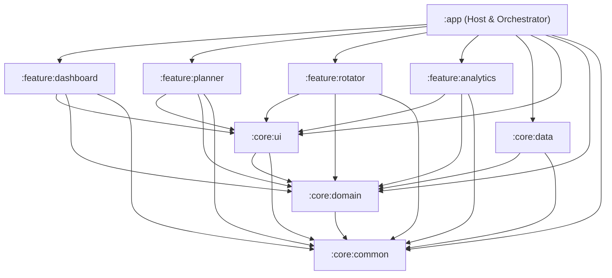

# SubCycler Architecture & Modularization 🏛️

This document outlines the architecture, design principles, module separation, and SOLID implementation for **SubCycler (SubTrack)**.

---

## 1. Architectural Principles & Patterns

The application follows the official **Google Recommended Architecture Guide for Android**, enforcing **Clean Architecture** and strict **SOLID principles**:

- **Single Responsibility Principle (SRP)**: Feature modules handle UI state and user intents; Use Cases encapsulate discrete domain business rules; Repositories manage data retrieval/persistence; Workers handle background evaluation.
- **Open/Closed Principle (OCP)**: Systems are extensible via interfaces (e.g. `TimeProvider`, `SubscriptionRepository`, `UserPreferencesRepository`) without modifying caller code.
- **Liskov Substitution Principle (LSP)**: Interface implementations (e.g., `FakeTimeProvider`, `FakeSubscriptionRepository`, `FakeUserPreferencesRepository`) substitute seamlessly in tests without affecting domain logic.
- **Interface Segregation Principle (ISP)**: Granular, focused use cases (`GetSubscriptionCycleStatusesUseCase`, `GetPortfolioSummaryUseCase`, `AlignPairedSubscriptionsUseCase`, `ManageSubscriptionUseCase`) instead of monolithic God-classes.
- **Dependency Inversion Principle (DIP)**: High-level business logic depends on domain abstractions, not concrete Room DAOs or system APIs. Injected via **Hilt (Dagger)**.

---

## 2. Multi-Module Project Hierarchy

```
SubCycler
 ├── :core:common       (Dispatchers qualifiers, TimeProvider abstractions, testing fakes)
 ├── :core:domain       (Pure business logic, Domain models, RotationEngine, Use Cases, Repository interfaces)
 ├── :core:data         (Room Database, DataStore Preferences, Repository implementations, Mappers, Hilt DI)
 ├── :core:ui           (Design system, SubTrackTheme, Typography, Shared Cards, Dialogs & Timeline views)
 ├── :feature:dashboard (Dashboard Route, Screen, ViewModel, MVI UI State/Actions)
 ├── :feature:planner   (45-day Planner Route, Screen, ViewModel)
 ├── :feature:rotator   (Paired Swap Rotator Route, Screen, ViewModel)
 ├── :feature:analytics (Savings & Compounding ROI Route, Screen, ViewModel)
 └── :app               (Application class, MainActivity, NavHost, WorkManager, Receivers, Notifications)
```



---

## 3. Module Breakdown

### A. `:core:common` (`com.subtrack.core.common`)
- **Coroutines Dispatchers**: `@IoDispatcher`, `@DefaultDispatcher`, `@MainDispatcher` qualifiers and Hilt module.
- **Time Abstraction (`TimeProvider`)**: System clock wrapper (`DefaultTimeProvider`) and test double (`FakeTimeProvider`) for deterministic unit tests.

### B. `:core:domain` (`com.subtrack.core.domain`)
- **Pure Kotlin**: Free of Android SDK references (`android.*`), allowing rapid local JVM unit testing (<20ms).
- **Domain Models**: `Subscription`, `CycleStatus`, `NextAction`, `PortfolioSummary`, `SubscriptionPreset`, `UserPreferences`.
- **Domain Use Cases**:
  - `GetSubscriptionCycleStatusesUseCase`: Transforms subscription entities into real-time cycle phases (Active vs Blackout) and computes urgent cancellation actions.
  - `GetPortfolioSummaryUseCase`: Computes aggregate annual costs, optimized rotation spending, and compounding multi-year ROI.
  - `AlignPairedSubscriptionsUseCase`: Synchronizes two paired subscriptions (e.g., Netflix + Disney+) to alternate 30d/30d without service blackout overlap.
  - `ManageSubscriptionUseCase`: Handles subscription lifecycle (CRUD, toggle auto-renew cancellation).
- **Domain Repositories**: `SubscriptionRepository` and `UserPreferencesRepository` interfaces.

### C. `:core:data` (`com.subtrack.core.data`)
- **Room Persistence**: `AppDatabase`, `SubscriptionDao`, `SubscriptionEntity`, `Converters`.
- **Data Mappers**: Bidirectional conversion between `SubscriptionEntity` and domain `Subscription`.
- **DataStore Preferences**: `UserPreferencesRepositoryImpl` providing non-blocking `Flow<UserPreferences>`.
- **Repository Implementation**: `SubscriptionRepositoryImpl` managing Room database access on `@IoDispatcher`.
- **Hilt Dependency Injection**: `DataModule` and `UseCaseModule`.

### D. `:core:ui` (`com.subtrack.core.ui`)
- **Theme & Design System**: `SubTrackTheme`, `Color.kt`, `Type.kt`.
- **Reusable Components**: `SubscriptionCard`, `AddEditSubscriptionDialog`, `CycleTimelineView`, `NextActionBanner`, `SavingsSummaryCard`.

### E. Feature Modules (`:feature:*`)
- **`:feature:dashboard`**: Primary dashboard list with filtering chips, active/blackout status badges, and quick actions.
- **`:feature:planner`**: 45-day cycle multi-month timeline viewer and interactive future date inspector.
- **`:feature:rotator`**: 30d/30d zero-downtime alternating paired subscription synchronizer.
- **`:feature:analytics`**: Compounding multi-year savings charts and what-if optimizer simulator.
- **MVI / UDF**: Stateful `*Route` + Stateless `*Screen` + `*ViewModel` with immutable `UiState` and sealed `UiAction`.

### F. `:app` (`com.subtrack.app`)
- **Host Application**: `SubTrackApplication` with on-demand `HiltWorkerFactory` configuration.
- **Navigation**: `SubTrackNavHost` and type-safe destinations (`Screen.kt`).
- **Background & Broadcast**: `DailyCycleEvaluationWorker`, `WorkSchedulerManager`, `BootReceiver`, `SubscriptionAlarmReceiver`, `NotificationHelper`.

---

## 4. Testing & Verification

The architecture supports 100% test coverage without requiring physical devices or emulators:
- **`:core:domain` Unit Tests**:
  - `RotationEngineTest`: Verifies rotation mathematical cycles, phase dates, and cost savings.
  - `GetSubscriptionCycleStatusesUseCaseTest`: Verifies stream status calculation.
  - `AlignPairedSubscriptionsUseCaseTest`: Verifies paired schedule alignment logic.
  - `GetPortfolioSummaryUseCaseTest`: Verifies portfolio financial metrics.
- **`:core:data` Unit Tests**:
  - `SubscriptionMapperTest`: Verifies bidirectional conversion accuracy.
  - `UserPreferencesTest`: Verifies DataStore reactive updates.
- **`:feature:dashboard` Unit Tests**:
  - `DashboardViewModelTest`: Verifies MVI actions, coroutine scheduling with `StandardTestDispatcher`, and UI state emission.
- **`:app` Unit Tests**:
  - `DailyCycleEvaluationLogicTest`: Verifies background notification triggers and lead thresholds.

---

## 5. Development & Build Commands

- **Run all unit tests across all modules**:
  ```powershell
  $env:JAVA_HOME = "C:\Program Files\Android\Android Studio\jbr"
  $env:Path = "$env:JAVA_HOME\bin;$env:LOCALAPPDATA\Android\Sdk\platform-tools;$env:Path"
  .\gradlew.bat testDebugUnitTest
  ```

- **Build debug APK**:
  ```powershell
  .\gradlew.bat assembleDebug
  ```

- **Install and Launch on Device via ADB**:
  ```powershell
  adb install -r app/build/outputs/apk/debug/app-debug.apk
  adb shell am start -n com.subtrack.app/com.subtrack.app.MainActivity
  ```

---

## 6. Guidelines for Creating New Features

When adding a new feature (e.g. `:feature:settings` or `:feature:export`):
1. **Module Creation**: Create `feature/<name>/build.gradle.kts` and include `:feature:<name>` in `settings.gradle.kts`.
2. **Dependencies Flow**: Only depend on `:core:common`, `:core:domain`, and `:core:ui`. Never depend directly on `:core:data` or other feature modules.
3. **MVI Presentation Pattern**:
   - Define a single immutable `UiState` data class and a sealed `UiAction` interface.
   - Separate stateful `*Route` (collects `*ViewModel` state) and stateless `*Screen` (accepts `(uiState, onAction)`).
4. **Navigation Registration**: Register the route in `:app`'s `Screen.kt` and add a composable destination in `SubTrackNavHost.kt`.

---

## 7. Agentic Workflows & Android CLI Integration 🤖

For autonomous AI coding assistants (Antigravity/Gemini) and automated agentic pipelines interacting with this codebase:

1. **Environment Setup**:
   - Ensure the Android CLI is installed (`android --version`).
   - Run `android init` to configure SDK paths and initialize agent skills.
   - Run `android info` to verify connected AVDs and SDK levels.
2. **Fast Builds & Running**:
   - Prefer `android run --use-delta-install` for sub-second hot redeployments.
   - Run unit test suites via `./gradlew testDebugUnitTest`.
3. **UI State & Verification**:
   - Execute `android layout --pretty` to read UI component tree bounds and clickability in JSON without image rendering.
   - Use `android layout --diff` after triggering actions to verify UI transitions concisely.
   - Use `android studio render-compose-preview` for headless preview validations.
4. **Knowledge Base & Skills**:
   - Query authoritative Android documentation via `android docs search "<keyword>"`.

