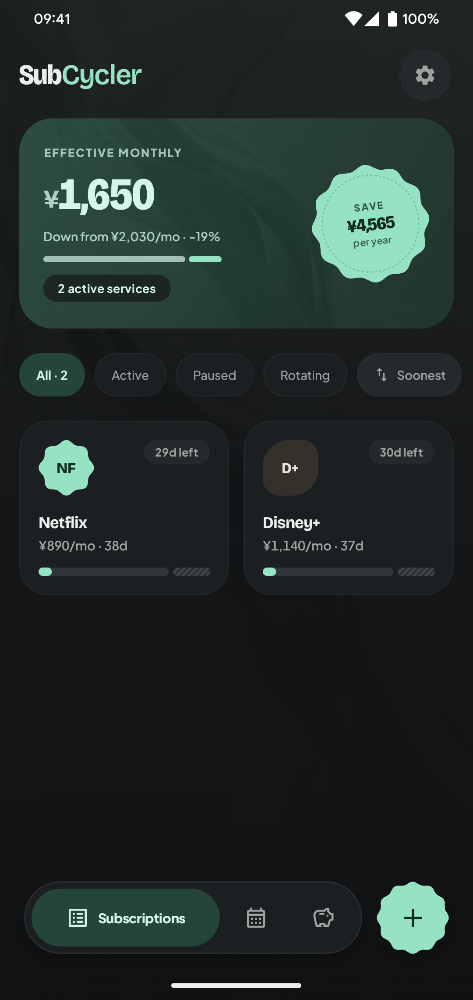
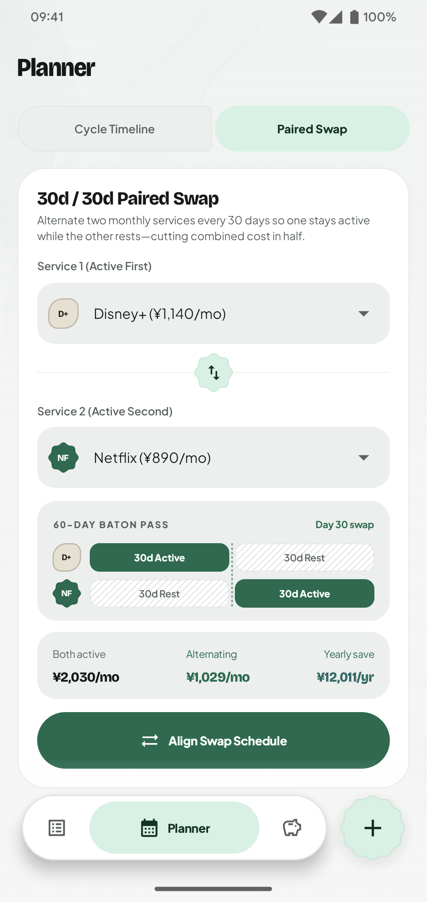
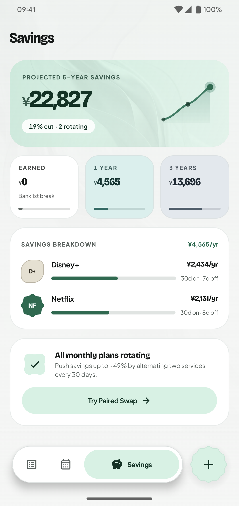

# SubCycler 🔄

> **Minimalist, 100% Offline 45-Day Subscription Manager for Android.**\
> *Binge your watchlist. Take a 15-day blackout. Cut your recurring subscription bills by 33%–50% with total privacy and zero internet permission.*

**Available today.** SubCycler is a local-first Android subscription manager for recurring bills, smart 45-day rotations, and non-interruptive renewal reminders.

---

## 🧠 The 45-Day Cycle Strategy

Standard subscriptions trap you in endless 30-day auto-debit loops—even when you're too busy to watch anything.

```
Standard:   [==== 30d Paid ====][==== 30d Paid ====]  --> 12 billings / yr
SubCycler:  [==== 30d Active ====][-- 15d Blackout --] -->  8 billings / yr
```

- **30 Days Active**: Enjoy your watchlist for 1 paid month.
- **15 Days Blackout**: Take 2 weeks off while new episodes accumulate and you catch up on life.
- **The Result**: Cut annual subscription bills by **33.3%** (or **50%** when pairing two alternating services).

---

## ✨ Features

- 🔒 **Total Privacy & Zero Internet / Exact-Alarm Permissions**: SubCycler never requests `android.permission.INTERNET` or `USE_EXACT_ALARM`. Zero ads, zero analytics, zero cloud tracking. All data stays 100% locally on your device via Room (SQLite) and DataStore.
- 🌿 **Adaptive Botanical Emerald Material 3 Expressive UI**: Calm 70% Neutral / 30% Botanical Emerald Light & Dark design (`System`, `Light`, or `Dark` in Settings) featuring bundled offline OFL variable typography (`Bricolage Grotesque` + `Plus Jakarta Sans`), 2-column Bento cards with cycle rhythm tracks, and a 3-tab split floating pill toolbar (`Subscriptions`, `Planner`, `Savings`) paired with a detached scalloped `+` button.
- ✍️ **Effortless Auto-Saving Multi-Step Setup & Incomplete Tracking**: Split into 3 compact steps (**Basics**, **Cycle**, **Notes**) with zero Save buttons—edits persist automatically and swipe-down dismissal is guarded so work is never lost. Leave optional details blank and finish them later via progressive **Incomplete** badges (`Needs price`, `Needs date`, `Needs cycle`) without triggering premature alerts.
- 🎛️ **Interactive Cycle Strategy Studio**: Pick `Always`, `Smart` (45-day), `Swap`, or `Custom` schedules with a live 90-day active/break rhythm ribbon and tactile `0d–45d` break slider.
- 💱 **Single App-Wide Currency & Curated Regional Tiers**: Pick your currency once on first launch with offline regional plan tier presets (`USD`, `JPY`, `EUR`, `GBP`, `CAD`, `AUD`, `INR`, `KRW`). Switching currency later in Settings shows an explicit offline manual-conversion warning instead of fabricating exchange rates.
- 🔔 **Non-Interruptive Subscribe / Unsubscribe Progress & Next-Launch Recovery**: Opening a provider billing link posts a silent active notification with **Completed** / **Cancel** actions, backed by persistent next-launch recovery if the notification is dismissed.
- 🔄 **Cycle Planner, Paired Swap & Editorial Savings Breakdown**: Inspect future active/break dates on proportional timelines, synchronize two alternating 30d/30d services with the 60-day Baton-Pass visualizer, and track earned savings alongside compounding `1Y → 3Y → 5Y` projections.
- 💾 **Offline JSON & CSV Backup/Restore + Home Screen Widget**: Export or restore your entire portfolio locally with zero cloud dependency, and keep your monthly spend and next action visible on your home screen.
- 🗓️ **Optional Calendar Awareness**: Disabled by default; uses selected device calendars locally to suggest timely subscription reviews after you opt in.

Android's system backup and device transfer settings can include the subscription database.

---

## 📸 Screenshots

| Home (Light) | Home (Dark) | Auto-Saving Cycle Studio |
| :---: | :---: | :---: |
|  |  |  |

| Cycle Timeline & Date Inspector | 30d / 30d Paired Swap | Editorial Savings & 5-Year ROI |
| :---: | :---: | :---: |
|  |  |  |

---

## 📚 Documentation Map

This repository maintains structured architectural blueprints and feature records:

- **[`PLANS.md`](PLANS.md)**: Master feature registry, implemented/postponed/cancelled feature logs, and specification links.
- **[`plans/CORE.md`](plans/CORE.md)**: Foundational architecture, 45-day rotation math, and persistence blueprint.
- **[`plans/features/`](plans/features)**: Detailed specifications for implemented, postponed, and cancelled features.
- **[`ARCHITECTURE.md`](ARCHITECTURE.md)**: Clean Architecture boundaries, SOLID guidelines, and multi-module dependency graphs.
- **[`DESIGN.md`](DESIGN.md)**: Botanical Emerald Material 3 Expressive design system, bundled variable typography, and component tokens.

---

## 🛠️ Tech Stack

- **Mobile Client**: Kotlin 2.0 + Jetpack Compose + Material 3
- **Local Persistence**: Room (SQLite) + Preferences DataStore + Kotlin Coroutines & Flow
- **Background Scheduling**: `AlarmManager` + `WorkManager` + `BroadcastReceiver`
- **Build System**: Gradle 8.7 + Android Gradle Plugin 8.5+

---

## 🚀 Quick Start

Use JDK 17 and install Android SDK Platform 35 through [Android Studio](https://developer.android.com/studio) or the SDK Manager. Run the app on an Android 8.0 (API 26) or newer device or emulator. For terminal builds, set `ANDROID_HOME` if Android Studio has yet to create `local.properties`, and add SDK Platform-Tools to your `PATH` for `adb`.

If you're starting fresh, clone [SubCycler](https://github.com/SafalFrom2050/SubCycler) and run these commands from the repository root. On Windows PowerShell, use `.\gradlew.bat` for the Gradle commands below.

### 1. Build the Android App
```bash
./gradlew assembleDebug
```
The APK will be generated at `app/build/outputs/apk/debug/app-debug.apk`.

### 2. Install on Device / Emulator
```bash
adb install "app/build/outputs/apk/debug/app-debug.apk"
```

### 3. Run Unit Tests
```bash
./gradlew testDebugUnitTest
```

---

## 🤖 Android CLI Workflow

This project supports **Agent-First Development** using the official **Android CLI** (`android`):

### 1. Environment Setup & Skill Initialization
```bash
android init
android info
```

### 2. Fast Incremental Build & Deployment
```bash
android run --use-delta-install
```

### 3. UI Inspection & Debugging
```bash
android layout --pretty
android screen capture --annotate -o app_screen.png
```

---

## 🤝 Contribute

Pull requests are welcome. Pick a [good first issue](https://github.com/SafalFrom2050/SubCycler/contribute) or open a [bug report or feature request](https://github.com/SafalFrom2050/SubCycler/issues/new/choose).

See the [contributor guide](CONTRIBUTING.md) for the fork-to-PR steps and CI commands, and the [security policy](SECURITY.md) for private vulnerability reports.

---

## 📄 Open Source License

Distributed under the **[MIT License](LICENSE)**. Free to use, fork, and build upon.

The bundled Gradle Wrapper files are available under the [Apache License 2.0](https://www.apache.org/licenses/LICENSE-2.0).
