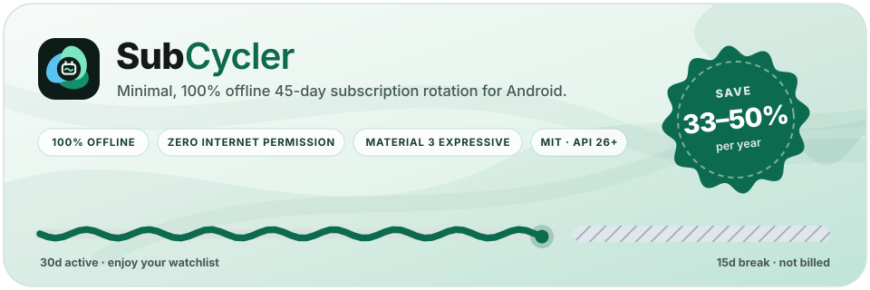
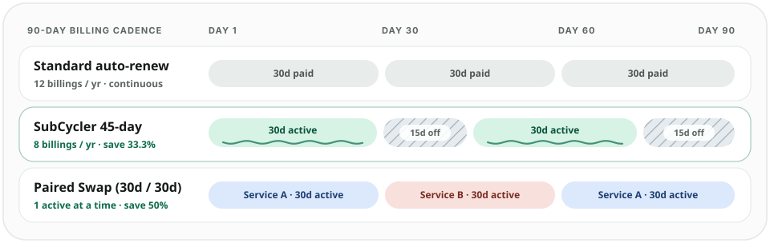
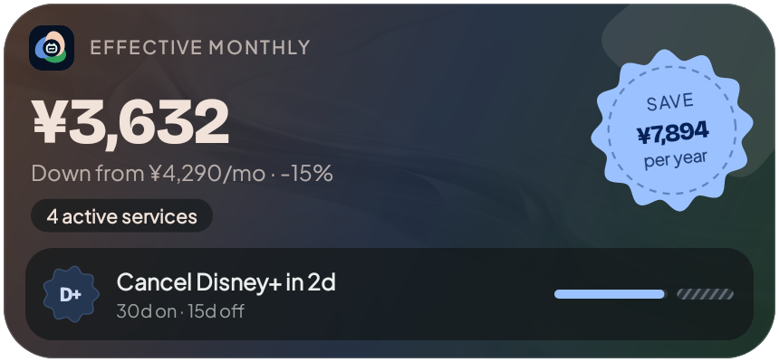
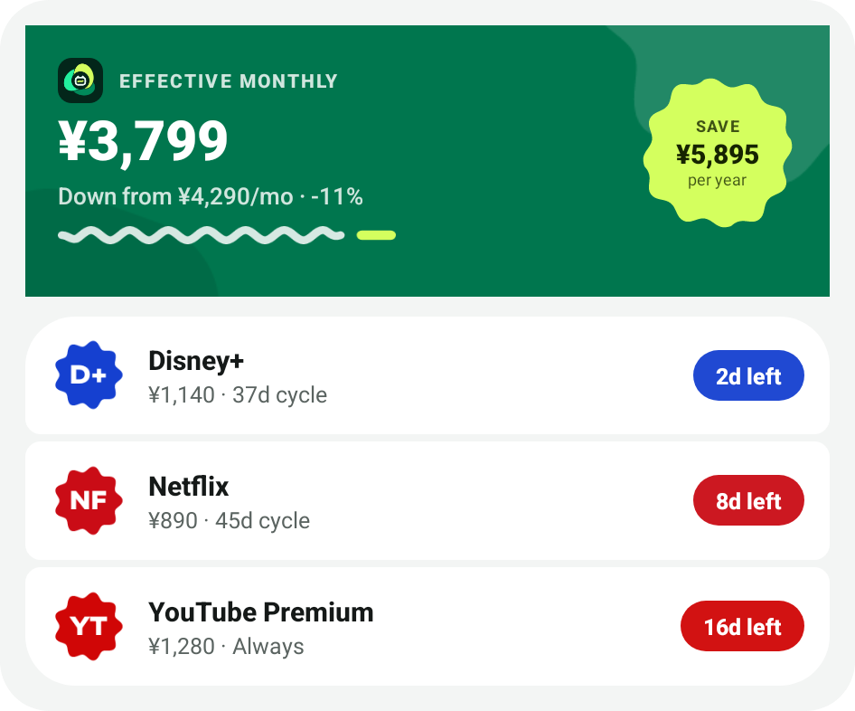
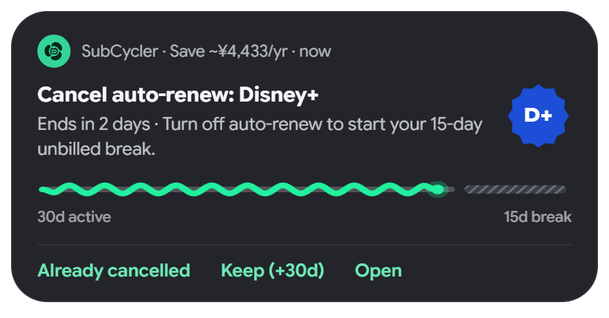
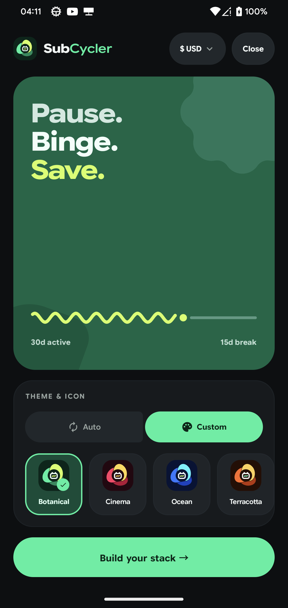
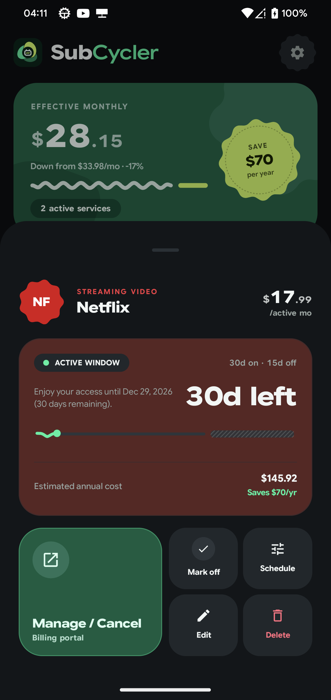
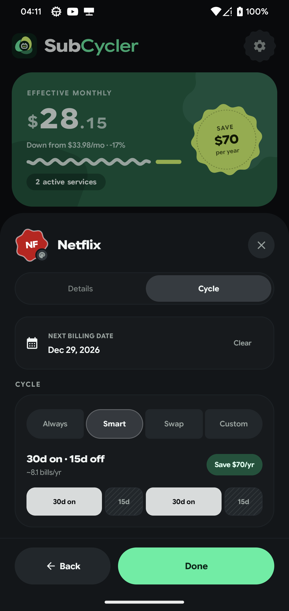
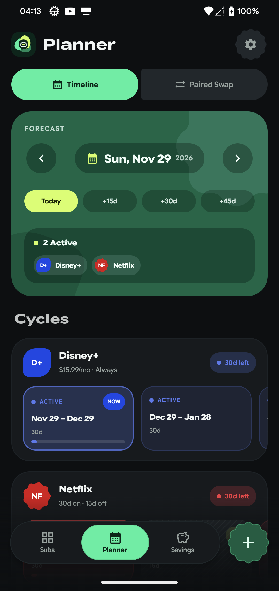

<div align="center">

<picture>
  <source media="(prefers-color-scheme: dark)" srcset="docs/assets/readme-hero-dark.svg">
  <source media="(prefers-color-scheme: light)" srcset="docs/assets/readme-hero-light.svg">
  
</picture>

<br>

**Binge your watchlist. Take a 15-day break. Cut recurring subscription bills by 33%–50% — with total local privacy and zero internet permission.**

<p>
  <a href="#the-45-day-cycle-strategy">Strategy</a> &nbsp;·&nbsp;
  <a href="#capabilities">Capabilities</a> &nbsp;·&nbsp;
  <a href="#home-screen-widgets">Widgets</a> &nbsp;·&nbsp;
  <a href="#expressive-alerts">Alerts</a> &nbsp;·&nbsp;
  <a href="#interface">Interface</a> &nbsp;·&nbsp;
  <a href="#design-system--documentation">Design System</a> &nbsp;·&nbsp;
  <a href="#quick-start">Quick Start</a>
</p>

</div>

---

## The 45-Day Cycle Strategy

Standard streaming and digital subscriptions lock you into 12 back-to-back auto-debits per year — even during weeks when you barely open them. SubCycler turns that passive billing loop into a calm, intentional rhythm.

<p align="center">
  <picture>
    <source media="(prefers-color-scheme: dark)" srcset="docs/assets/cycle-rhythm-dark.svg">
    <source media="(prefers-color-scheme: light)" srcset="docs/assets/cycle-rhythm-light.svg">
    
  </picture>
</p>

| Cadence | Cycle Rhythm | Billings / Year | Annual Savings |
| :--- | :--- | :---: | :---: |
| **Standard Auto-Renew** | 30d paid, continuous | 12 | 0% |
| **SubCycler 45-Day** | 30d active · 15d unbilled break | 8 | **33.3%** |
| **Paired Swap (30d / 30d)** | Two alternating services, one active at a time | 6 each | **50.0%** |

---

## Capabilities

### Privacy-First Local Core
- **Zero Internet & Zero Exact-Alarm Permissions** — SubCycler never declares `android.permission.INTERNET` or `USE_EXACT_ALARM`. No ads, no telemetry, no accounts, and no cloud sync. Everything stays in local Room (SQLite) and Preferences DataStore *(Android's system backup and device transfer settings can include the local database)*.
- **Single App-Wide Currency & Offline Regional Tiers** — Pick your currency directly from the Welcome top bar with curated offline plan tiers (`USD`, `JPY`, `EUR`, `GBP`, `CAD`, `AUD`, `INR`, `KRW`). Changing currency later in Settings shows an explicit offline manual-conversion notice instead of fabricating exchange rates.
- **Optional Local Calendar Awareness** — Disabled by default; once enabled, reads selected on-device calendars locally to suggest timely subscription reviews around travel or busy stretches.

### Material 3 Expressive Craft
- **Bold Color-Block Heroes & Triadic Pop Seals** — Calm Alabaster (Light) and Obsidian-Graphite (Dark) canvases frame pure flat jewel-colored hero blocks accented with high-contrast triadic `Cookie12` savings seals, animated curly rhythm waves, and true-hue harmonized service vessels (zero third-party trademarked logos).
- **2-Mode Adaptive Theme & Auto-Matching Launcher Icon** — Default **Auto** (`Adapt to subscriptions`) automatically adapts the app accent tokens, 3-petal top-bar swirl, home-screen widgets, notifications, and Android launcher icon to your active stack mood. Switch to **Custom** in Welcome or Settings to pick freely from **6 curated Bold Color-Block themes & launcher icons** (`Botanical`, `Cinema`, `Ocean`, `Terracotta`, `Aurora`, `Obsidian`, plus Android 13+ monochrome themed icons).
- **Unified Offline Google Sans Flex Typography** — Bundles 8 offline SIL OFL v1.1 **Google Sans Flex** cuts across three expressive width tiers: **Expanded (`wdth = 125`)** for screen titles and softly faded section headers (`Your stack`, `Cycles`, `Breakdown`), **Semi-Wide (`wdth = 112.5`)** for hero spend numerals and card titles, and **Standard (`wdth = 100`)** for body copy, chips, buttons, and inputs.
- **Zero-Jank Gliding Liquid Dock & Reactive Motion** — Persistent hardware-layer tab slots deliver smooth decoupled fade-through transitions between `Subs`, `Planner`, and `Savings`, paired with spring-reactive icons, full-height filter swiping (`All`, `Active`, `Paused`, `Rotating`), and an interactive Welcome preview right from Settings.

### Rotation Studio, Planner & Offline Stack Sharing
- **Minimal 2-Tab Auto-Saving Editor (`Details` · `Cycle`)** — Calm monochrome utility sheet with zero Save buttons, tucked Brand Color customization behind the service badge, swipe-down protection, and progressive incomplete badges (`Needs price`, `Needs date`, `Needs cycle`).
- **Interactive Cycle Studio & Wave Scrubber** — Switch between `Always`, `Smart` (45-day), `Swap`, and `Custom` schedules with a live 90-day active/break ribbon (surfacing the break slider and active-window stepper only in `Custom`), and scrub future dates directly on the subscription detail sheet's curly progress wave.
- **Planner, Paired Swap & Editorial Savings** — Forecast active and rest windows with quick-jump presets (`Today`, `+15d`, `+30d`, `+45d`) and uniform snap-fling brand timelines, pair two alternating 30d/30d services in the 60-day Baton-Pass studio, and track banked savings alongside `1Y → 3Y → 5Y` compounding projections.
- **Offline QR Stack Cards & Short Links** — Export a branded PNG **Stack Card** with embedded QR code, scan live in-app QRs, or share compact `subcycler://s/...` deep links and `.subcycler` backup files with a 1-tap privacy toggle for notes and savings history.

---

## Home-Screen Widgets

Two 100% offline native `RemoteViews` widgets sync live with your active **Living Stack Mood**, **App Icon accent**, and **Light/Dark Theme**:

- **SubCycler · Living Pulse** — Responsive across **`2×2`** (Compact Color-Block + Triadic seal), **`4×2`** (Hero + Next-Up cancellation ribbon), and **`4×3`** (Hero + top 3 individually clickable service rows).
- **SubCycler · Next Up Cookie** — Sculptural **`2×2`** floating silhouette (`10`-petal cookie for rotating cycles, squircle for continuous, `12`-petal sunny seal when a break is ready to bank) on a transparent canvas with a sweeping perimeter progress ring.

<div align="center">

| Living Pulse · 2×2 (Dark) | Next Up Cookie · 2×2 (Floating Silhouette) |
| :---: | :---: |
|  |  |

| Living Pulse · 4×2 (Ocean Accent) | Living Pulse · 4×3 (Light · Cycle Vessel Deck) |
| :---: | :---: |
|  |  |

</div>

---

## Expressive Alerts

Local `AlarmManager` and `WorkManager` reminders use **Hybrid Native Android Notifications** (`DecoratedCustomViewStyle`) that respect the system shade, font scaling, and Dark/Light surfaces:

- **Borderless Bold Jewel Monogram Badges** — Organic scalloped `LargeIcon` badges (`Cookie9` / `Sunny12`) harmonized to each service.
- **Transparent Curly Rhythm Strips** — Slim live 2-zone curly active + `45°` hatched break strip rendered directly on the native shade surface with zero boxed card chrome.
- **1-Tap Inline Shade Actions** — Tap **`Already cancelled`**, **`Keep (+30d)`**, or **`Bank & Resume`** right from the shade to update Room, reschedule alarms, and refresh widgets without opening the app.
- **Quiet 2-Step Action Progress & Settings Preview** — Opening a provider billing link posts a silent progress alert (`Step 1` → `Step 2 · Tap Completed`) with next-launch recovery. Preview both alert styles anytime from **Settings → Notifications & Calendar → Preview alerts**.

<div align="center">

| Hybrid Cycle Rhythm Alert | 2-Step Action Progress Alert |
| :---: | :---: |
|  |  |

</div>

---

## Interface

<div align="center">

| Welcome · Rhythm & Theme | Home · Light | Home · Dark |
| :---: | :---: | :---: |
|  |  |  |

| Cycle Detail & Wave Scrubber | Minimal 2-Tab Cycle Studio | Planner · Cycle Timeline |
| :---: | :---: | :---: |
|  |  |  |

| Planner · Paired Swap | Savings & 5-Year ROI | Appearance & Adaptive Icon |
| :---: | :---: | :---: |
|  |  |  |

</div>

---

## Design System & Documentation

SubCycler maintains architectural blueprints and design specifications alongside the codebase:

| Document | Scope |
| :--- | :--- |
| [`DESIGN.md`](DESIGN.md) | Material 3 Expressive tokens, Google Sans Flex typography, shapes, and motion |
| [`ARCHITECTURE.md`](ARCHITECTURE.md) | Clean Architecture boundaries, SOLID rules, and multi-module dependency graph |
| [`PLANS.md`](PLANS.md) | Master feature registry, status logs, and links into [`plans/features/`](plans/features) |
| [`plans/CORE.md`](plans/CORE.md) | Core 45-day rotation math, scheduling guarantees, and local persistence blueprint |
| [`docs/MATERIAL_EXPRESSIVE_UPGRADES_PROPOSAL.md`](docs/MATERIAL_EXPRESSIVE_UPGRADES_PROPOSAL.md) | Kinetic Architecture II specification: polygon morphing, wave scrubbing, and command decks |
| [`docs/BUNPOD_DESIGN_INSPIRATION.md`](docs/BUNPOD_DESIGN_INSPIRATION.md) | Material 3 Expressive craft study and offline adaptation guardrails |

---

## Tech Stack

| Layer | Technology |
| :--- | :--- |
| **UI & Motion** | Kotlin 2.0 · Jetpack Compose · Material 3 · `androidx.graphics:graphics-shapes` · Google Sans Flex (OFL) |
| **Local Data** | Room (SQLite) · Preferences DataStore · Kotlin Coroutines & Flow |
| **Scheduling & Widgets** | `AlarmManager` · `WorkManager` · `BroadcastReceiver` · Native `RemoteViews` Widgets & Hybrid Alerts |
| **DI & Build** | Hilt · Gradle 8.7 · Android Gradle Plugin 8.5+ · Android 8.0+ (API 26–35) |

---

## Quick Start

Install **JDK 17+** (or JDK 21) and **Android SDK Platform 35** via [Android Studio](https://developer.android.com/studio) or the SDK Manager. Run on any Android 8.0 (API 26) or newer device or emulator. On Windows PowerShell, use `.\gradlew.bat`.

```bash
# 1. Build the debug APK
./gradlew assembleDebug

# 2. Install on a connected device or emulator
adb install "app/build/outputs/apk/debug/app-debug.apk"

# 3. Run unit tests
./gradlew testDebugUnitTest

# 4. Run on-device instrumentation tests (includes offline permission & widget render checks)
./gradlew connectedDebugAndroidTest
```

### Android CLI Workflow

SubCycler also supports the official **Android CLI** (`android`) for fast incremental loops and UI inspection:

```bash
android init && android info
android run --use-delta-install
android layout --pretty
android screen capture --annotate -o app_screen.png
```

---

## Contributing & License

Pull requests, bug reports, and design suggestions are welcome — browse [good first issues](https://github.com/SafalFrom2050/SubCycler/contribute) or open a [new issue](https://github.com/SafalFrom2050/SubCycler/issues/new/choose).

- Contribution guide: [`CONTRIBUTING.md`](CONTRIBUTING.md)
- Security policy: [`SECURITY.md`](SECURITY.md)
- License: **[MIT License](LICENSE)** (bundled Gradle Wrapper files under Apache License 2.0; bundled Google Sans Flex fonts under SIL OFL 1.1)
