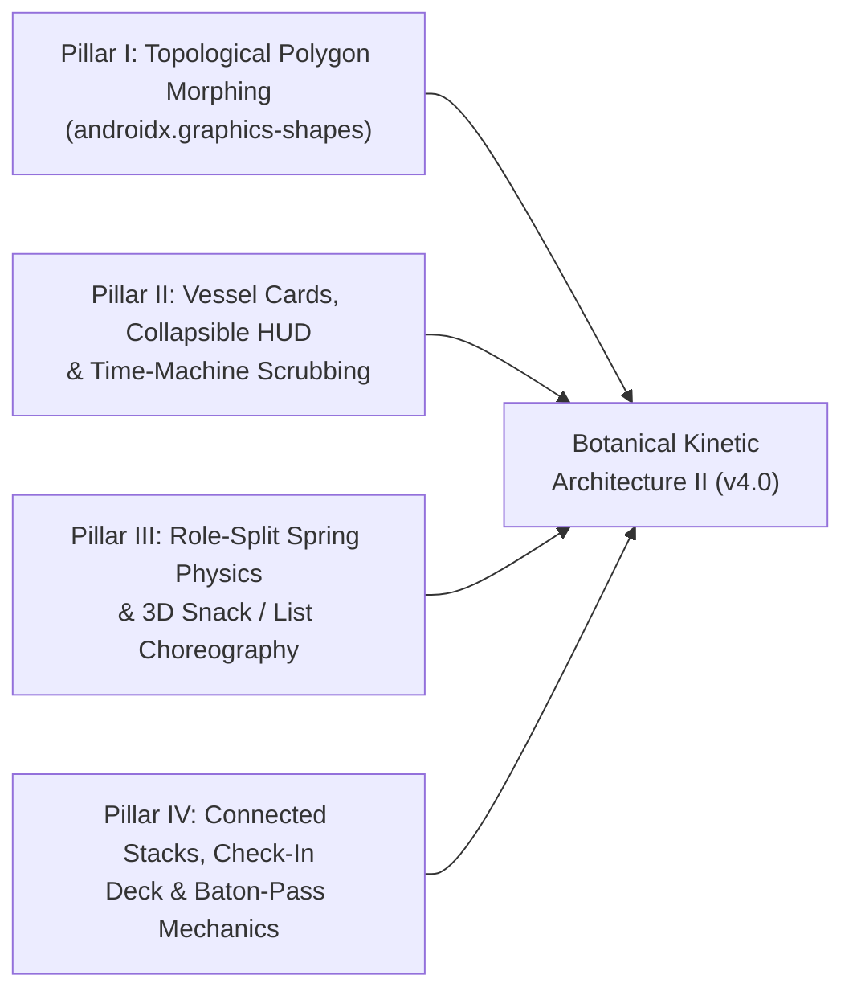
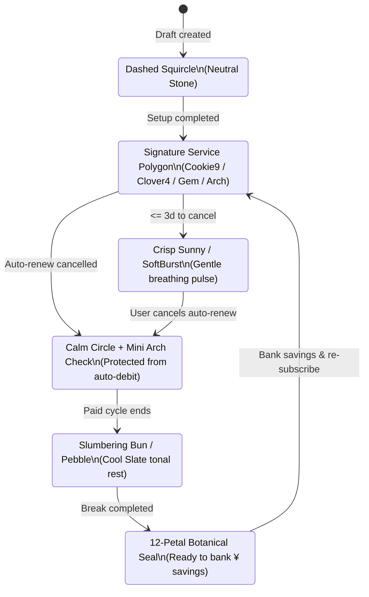

# Proposal: Material 3 Expressive Upgrades (v4.0 — "Botanical Kinetic Architecture II")

> **Status**: Implemented & Device-Verified (v4.0.0)  
> **Inspired By**: [BunPod (`kamranbekirovyz/bunpod`)](BUNPOD_DESIGN_INSPIRATION.md) + Android 16 Material 3 Expressive (`androidx.graphics:graphics-shapes`)  
> **Baseline**: [`DESIGN.md` v4.0.0](../DESIGN.md) (upgraded from v3.5.0)  
> **Non-Negotiable Constraints**: 100% Offline (`zero INTERNET`, `zero USE_EXACT_ALARM`) · 70% Architectural Neutral / 30% Botanical Emerald Adaptive Light & Dark · Zero Third-Party Logos · Full Reduced-Motion (`ANIMATOR_DURATION_SCALE`) Compliance

---

## 1. Creative Vision: From "Styled Surfaces" to "Living Financial Instruments"

SubCycler v3.5.0 established a calm, high-craft **70% Neutral / 30% Botanical Emerald** visual foundation with variable typography (`Bricolage Grotesque` + `Plus Jakarta Sans`), scalloped badges, and a 3-tab split floating dock.

Drawing inspiration from [**BunPod**](BUNPOD_DESIGN_INSPIRATION.md), **Edition II (v4.0)** pushes SubCycler from *expressively styled cards* to **physically alive financial instruments**—where polygons morph topologically to telegraph billing states, progress bars scrub through future rotation dates under your thumb, detail sheets organize actions into asymmetric tactile Bento decks, and list items collide and settle with real spring momentum.



---

## 2. Pillar I — Topological Polygon Morphing & Tactile Geometry

### Upgrade 1: Lifecycle-Aware Polygon Morphing & Anticipatory Press-Preview
Replace manual 120-segment `lineTo` paths (`ScallopedCookieShape`) with Jetpack's tiny, 100% offline **`androidx.graphics:graphics-shapes`** (`RoundedPolygon` + cubic-Bézier `Morph`).

- **Semantic Phase Silhouettes (`MorphingServiceBadge`)**:
  Every subscription's monogram badge holds a deterministic resting polygon (`Cookie9Sided`, `Clover4Leaf`, `Puffy`, `Arch`, `Gem`, `Sunny`), then **morphs continuously** when its rotation lifecycle changes:



- **Anticipatory Press-Preview (BunPod `FavButton` Technique)**:
  - **Shape previews intent on `Press`; color commits on `Release`.**
  - Pressing down on a toggleable control (e.g., *Mark Auto-Renew Cancelled*, *Filter Pill*, *Detached `+` FAB*, or *Bento Action Tile*) immediately morphs the outline toward its destination geometry (`Circle → Cookie8` or `Superellipse(28dp) → TightSquircle(14dp)`) on `ExpressiveSpatialFast`, while the tonal fill transitions only when the tap completes.

---

### Upgrade 2: The "Vault Mosaic" Interactive Welcome & Fanned Stack Bar
Inspired by BunPod's `ChannelWall` and `OpmlShapeStack`:

- **Gapless-to-Expressive Monogram Mosaic (`WelcomeStep` & `DashboardEmptyState`)**:
  - The Welcome header opens with an edge-to-edge **gapless grid of crisp square tiles** in SubCycler's 70/30 neutral-and-emerald shades (`WarmSand`, `CoolSlate`, `FreshMint`, `CoolJade`, `DeepEmerald`) displaying curated `Bricolage Grotesque` monograms (`NF`, `D+`, `SP`, `AI`, `YT`, `CL`, `PV`, `XB`).
  - After a deliberate **`280ms` beat**, every square **morphs simultaneously on an expressive spatial spring** into 10 distinct `MaterialShapes` silhouettes, opening airy alabaster/obsidian breathing room between them.
  - **Tactile Easter Egg**: Tapping any monogram tile on the Welcome canvas morphs it into a fresh non-repeating polygon (`Gem → Flower → Clover4 → Bun → Cookie12`) with a soft haptic tick.
- **Spring-Fanned Selection Deck (`OnboardingStackBar`)**:
  - During Onboarding's *"Build Your Stack"* picker, each selected service deals into a **ringed overlapping badge stack** (`3dp` surface cutout ring, fanned horizontally by `step * i * springT` with slight card tilt that straightens on settle) beside the live monthly estimate.

---

## 3. Pillar II — Vessel Cards, Scroll Continuity & Time-Machine Scrubbing

### Upgrade 3: Dual-Layer "Cycle Vessel" Cards & Scalloped Break-Bank Stamps
Inspired by BunPod's `FeedEpisodeCard` (`_FillClipper`):

```
┌─────────────────────────────────────────┐  ┌─────────────────────────────────────────┐
│  ╭───╮                     ╭─────────╮  │  │ ░░░░░░░░░░░░░░░░░│                      │
│  │NF │                     │ 6d left │  │  │ ░╭───╮░░░░░░░░░░░│       ╭───────────╮  │
│  ╰───╯                     ╰─────────╯  │  │ ░│D+ │░░░░░░░░░░░│       │Paused · 8d│  │
│  ░░░░░░░░░░░░░░░░░░░░░░░░░░│            │  │ ░╰───╯░░░░░░░░░░░│       ╰───────────╯  │
│  Netflix ░░░░░░░░░░░░░░░░░░│            │  │ ░Disney+░░░░░░░░░│                      │
│  ¥890/mo · 45d ░░░░░░░░░░░░│            │  │ ░¥1,140/mo · 45d░│                      │
│  ●━━━━━━━━━━━━━━━━━━━──────  ╱╱╱╱╱╱╱╱   │  │  ─────────────────  ●━━━━━━━╱╱╱╱╱╱╱╱╱   │
└────────────────────────────┴────────────┘  └──────────────────┴──────────────────────┘
   Active Phase: Whisper-soft emerald           Blackout Phase: Subtle 45° diagonal
   ambient horizon fill (0..progress)           rest-hatch vessel sweeping across card
```

- **70/30 Ambient Horizon Vessel on Bento Cards (`SubscriptionGridItem`)**:
  - To preserve SubCycler's calm 70% neutral aesthetic, Bento cards gain a subtle **full-height ambient progress vessel** (`primaryContainer.copy(alpha = 0.24f)` during *Active*; `tertiaryContainer.copy(alpha = 0.30f)` with ultra-fine `45°` rest-hatching during *Blackout*) clipped horizontally from `0f` to `cycleStatus.progressFraction` behind the card content.
- **High-Contrast Dual-Layer Clip Inversion on `NextActionBanner`**:
  - Urgent action banners (*"Cancel Netflix within 2 days to start 15d break"*) use BunPod's exact **two-layer synchronized `clipRect` stack** so foreground text and icons invert crisply (`onPrimary` over `primary` fill vs. `onSurface` over `surfaceContainerHigh`) across the live countdown threshold.
- **1-Tap Scalloped "Bank Break" Stamp**:
  - When `hasUnbankedCompletedBreak == true`, the Bento card's top-right pill morphs into a rotated `Cookie7Sided` Botanical Emerald stamp (`+¥445 · Bank`) so users can bank realized break savings with a joyful spring pop.

---

### Upgrade 4: Scroll-Collapsible Efficiency HUD (`CollapsibleEfficiencyHud`)
Inspired by BunPod's `FeedNowPlayingCard` (`collapse: 0 → 1`):

- **Expanded State (`collapse = 0f`)**:
  - Full `FinancialEfficiencyHud` with masked silk-waves backdrop, `44sp` `ExpressiveMoneyText`, tilted `98dp` `Cookie12` annual savings seal, **plus a subtle off-corner `170dp` `Clover8Leaf` tonal watermark** (`top = -38.dp, end = -32.dp`, `alpha = 0.08f`) that rotates gently (`0° → 18°`) with scroll momentum.
- **Pinned Capsule State (`collapse = 1f`)**:
  - As the user scrolls past the Hero card in `DashboardScreen`, a `NestedScrollConnection` smoothly morphs the `28dp` Hero card into a **pinned `52dp` stadium summary pill** beneath the top bar:
    - **Left**: `¥1,650/mo` (`ExpressiveMoneyText` compact) + `· -19%` emerald tag.
    - **Right**: Mini `34dp` `Cookie12` `[ Save ¥4,565/yr ]` interactive chip that still jumps straight to the `Savings` tab.

---

### Upgrade 5: Asymmetric "Command Deck" Detail Sheet & Cycle Time-Machine Scrubber
Inspired by BunPod's `PlayerPage`, `PlayerProgress`, and `PlayerControls`:

Currently, `SubscriptionDetailBottomSheet` stacks full-width horizontal buttons one below another. In v4.0, it becomes a **bottom-weighted tactile Command Deck**:

```
┌──────────────────────────────────────────────────────────┐
│                         ──────                           │
│  ╭────╮  NETFLIX · ENTERTAINMENT                         │
│  │ NF │  ¥890 / active mo              Saves ¥3,560/yr   │
│  ╰────╯                                                  │
│                                                          │
│  ACTIVE · Cancel by Dec 22                     24d left  │
│  ∿∿∿∿∿∿∿∿∿∿∿∿∿●───────────────────────  ╱╱╱╱╱╱╱╱╱╱╱╱╱╱   │
│  ▲ Drag wave to preview future dates & break savings!    │
│                                                          │
│  ┌─────────────────────────┐  ┌───────────┐ ┌──────────┐ │
│  │                         │  │   ╭───╮   │ │   +30d   │ │
│  │          ↗              │  │   │ ✓ │   │ │   Skip   │ │
│  │                         │  │   ╰───╯   │ │  Break   │ │
│  │     Cancel / Manage     │  │Auto-Renew │ │          │ │
│  │      Auto-Renew         │  └───────────┘ └──────────┘ │
│  │                         │  ┌───────────┐ ┌──────────┐ │
│  │   (Superellipse 28dp    │  │   ✎ Edit  │ │ 🗑 Delete │ │
│  │    → 16dp on press)     │  │   Setup   │ │          │ │
│  └─────────────────────────┘  └───────────┘ └──────────┘ │
└──────────────────────────────────────────────────────────┘
```

1. **Interactive "Cycle Time-Machine" Wavy Scrubber**:
   - Pair a monumental right-aligned `DisplayHeroFontFamily` tabular countdown (`24d left` / `-8d rest`, `44sp`, `-1.5sp` tracking) directly above `WavyProgressIndicator`.
   - Touching or dragging horizontally across the wave **flattens the sinusoidal wave (`amplitude: 3.dp → 0.dp`) and thickens the track (`3.5.dp → 6.dp`)** on `ExpressiveSpatialFast`.
   - As your thumb scrubs across the 45-day (or 60-day) span, the header dynamically previews that exact day's state (*"Thu, Dec 24 · Day 2 of 15d Break · Unbilled rest"*), firing **subtle tick haptics at every day boundary** and a **crisp rigid haptic tick** right at the Active → Break transition seam! Releasing springs smoothly back to Today.
2. **50 / 50 Asymmetric Bento Command Matrix (`SubscriptionCommandDeck`)**:
   - **Left 50% (Square Hero Action Tile)**: Houses the single most important lifecycle action (*Cancel Auto-Renew ↗*, *Re-subscribe ↗*, *Bank Break Savings*, or *Finish Setup*). Uses a `RoundedPolygon` superellipse (`28dp` rest → `14dp` pressed; morphs to a serene `Cookie12` `"Coasting ✓"` tile once auto-renew is marked cancelled).
   - **Right 50% (`2×2` Tactile Sub-Grid, `6dp` inner seams)**:
     - **Top-Start**: *Auto-Renew Cancelled Toggle* (previews `Circle → Gem` polygon morph on press, fills `primaryContainer` on commit).
     - **Top-End**: *`+30d` Skip Break* (or quick-jump to *Cycle Studio* when >10 days out).
     - **Bottom-Start**: *Edit* (`POP_BOUNCE` icon).
     - **Bottom-End**: *Delete* (neutral `surfaceContainerHigh` at rest; tapping expands inline across the bottom row into `Cancel | Confirm Delete` with zero jarring popup dialog).

---

## 4. Pillar III — Physics-Driven Spatial Choreography & Feedback

### Upgrade 6: Role-Split Spring Physics & Clamped/Unclamped Channel Separation
Create `core/ui/src/main/java/com/subtrack/core/ui/theme/Motion.kt` enforcing strict Material 3 Expressive motion semantics:

| Token | Damping Ratio | Stiffness | Overshoot? | Assigned UI Surfaces |
| :--- | :---: | :---: | :---: | :--- |
| **`ExpressiveSpatialFast`** | `0.62f` | `600f` | **Yes** | Badge polygon morphs, press-preview shapes, wave scrub grab, snack depth hops, baton-pass flip |
| **`ExpressiveSpatialDefault`** | `0.68f` | `380f` | **Yes** | Bottom sheet enter/rebound, two-beat slot collapse, onboarding card arrival, check-in deck slide |
| **`ExpressiveSpatialSlow`** | `0.74f` | `180f` | **Subtle** | Savings 5-year curve draw-in, ambient off-corner `ShapeBloomBackdrop` breathing |
| **`StandardSpatialFast`** | `0.95f` | `700f` | **No** | Filter strip auto-scroll (`25%..75%` comfort band), segmented seams, sheet exit, beat-1 card implode |
| **`EffectsFast` / `EffectsDefault`** | `1.00f` | `800f / 450f` | **Never (Clamped)** | Color fills, scrim opacity (`coerceIn(0f, 1f)`), border alpha, elevation shadows |

- **Velocity-Preserving Sheet Rubberbanding**: Upgrade SubCycler's sheets so dragging past fully expanded applies hyperbolic overdrag resistance (`1f / (1f + overshoot * 100f)`), and releasing a downward fling injects the finger's exact pixel/sec velocity into the closing spring while clamping scrim alpha to `[0f, 1f]`.

---

### Upgrade 7: 3D Stacked `ExpressiveSnackStack` with Concentric `Arch` Chip
Inspired by BunPod's `packages/expressive_snack`:

- Replace standard `SnackbarHost` with a custom **`ExpressiveSnackHost`** hovering above the Split Floating Pill Toolbar:
  - **Card-Stack Depth Physics**: Multiple rapid actions (e.g., Quick-adding 3 presets or deleting 2 items) deal `inverseSurface` **Stadium pills** into a 3D stack (`12dp` upward peek per depth step, `5%` scale step-down, `15%` progressive shadow veil).
  - **Concentric Rotated `Arch` Chip**: Leading icon sits inside a `32dp` `MaterialShapes.Arch` badge rotated `-90°` (LTR) / `+90°` (RTL) so its rounded dome nests concentrically into the left stadium cap—or displays the affected subscription's mini organic monogram badge!
  - **Tactile Gestures & Duplicate Impulse Wobble**: Touch-and-hold pauses the auto-dismiss timer; short downward swipe (`>24dp`) flings the pill away; triggering a duplicate message injects a horizontal `SpringSimulation` velocity impulse (`600dp/s` around `0`) so the pill physically wobbles and settles instead of stacking duplicates.

---

### Upgrade 8: Two-Beat Physical Card Removal & Staggered Portfolio Arrival
Inspired by BunPod's `RemovalCollapse` and `FeedArrival`:

- **Two-Beat Delete & Undo Re-Entry**:
  - **Beat 1 (Implode)**: Deleted card shrinks (`scale: 1f → 0f`, `alpha: 1f → 0f`) inside its Bento cell on `StandardSpatialFast`, briefly leaving a clean spatial void.
  - **Beat 2 (Neighbor Collision)**: The row/cell collapses on `ExpressiveSpatialDefault`; clamping negative spring overshoot to `0f` while allowing positive rebound (`0.04f`) makes neighboring cards **visibly kiss and bounce apart by a few pixels** before resting. Tapping **Undo** in the `ExpressiveSnackStack` reverses the spring, prying the slot open!
- **Staggered Onboarding Deal**:
  - Exiting First-Launch Onboarding deals the newly created Bento rows onto `DashboardScreen` with a `120ms` stagger + light selection haptic tick per row.

---

## 5. Pillar IV — Connected Stacks, Check-In Decks & Kinetic Planner

### Upgrade 9: Positional Connected Card Stacks (`ExpressiveSectionStack`)
Inspired by BunPod's `MenuSection` (`outerRadius = 28.dp`, `innerRadius = 4.dp`, `tileGap = 2.dp`):

- Replace repetitive standalone rounded rectangles with **sculptural `2dp`-gapped connected stacks** where outer caps curve generously (`28dp`), inner seams sit crisp and architectural (`4dp`), and **pressing any row springs its adjacent `4dp` seams out to `14dp`**:
  1. **Settings Sheet (`CalendarAwarenessComponents.kt`)**:
     - *Preferences Stack*: `Appearance` · `App Currency` · `Reminder Timing`.
     - *Local Vault Stack*: `Export JSON Backup` · `Restore from JSON` · `Export CSV Ledger`.
  2. **Savings Breakdown (`AnalyticsScreen.kt`)**:
     - Per-service ROI rows lock together into a unified ranked stack where each tile's background subtly fills proportionally to its share of total annual savings.
  3. **Billing Destination Picker (`CancellationOptionsDialog.kt`)**:
     - `Direct Provider Account Page` · `Google Play Subscriptions` · `Apple App Store Steps` presented as a crisp 3-part tactile stack.

---

### Upgrade 10: Comfort-Band Morphing Filter Strip & Kinetic Baton-Pass Swap
- **Embedded-Badge Filter Strip (`DashboardScreen.kt`, Inspired by `FeedChannelTabs` & `FeedSectionHeader`)**:
  - Idle filter chips rest as `12dp` squircles and **spring-morph into `22dp` full pills** when selected.
  - Horizontal scroll controller uses a **Comfort-Band Nudge (`25%..75%` of viewport width)**: selecting a chip near the screen edge gently reveals the next neighbor without snapping every tap dead-center.
  - Filter labels pair with compact `10dp`-radius tabular count chips (`Bricolage Grotesque`), and selecting `Paused` or `Rotating` fans mini ringed service badges right inside the filter summary.
- **Mechanical Railway Baton-Pass (`PlannerScreen.kt` — `Paired Swap`)**:
  - Upgrade the divider icon between *Service 1* and *Service 2* into a **spring-flippable `Cookie9Sided` Baton Button**. Tapping it exchanges Service 1 ↔ Service 2 along opposing vertical arcs while the 60-day `[ 30d Active ]` and `[ 30d Hatched Rest ]` blocks physically slide across the Day-30 centerline with synchronized swap haptics.

---

### Upgrade 11: Interactive "Cycle Check-In" Card Deck (`CycleCheckInDeck`)
Inspired by BunPod's `OpmlSuggestionDeck`:

- Whenever 2+ items require quick confirmation (e.g., returning after a trip with 2 finished breaks to bank, a pending billing link confirmation, or 2 `Incomplete` drafts missing prices), replace modal dialog queues with an **inline top-of-feed Check-In Deck**:
  - Header shows `QUICK CHECK-IN` + tabular `1 of 3` counter + **spring-stretching stadium progress dots** (`8dp` dots that stretch to `28dp` capsules for the active card).
  - Resolving a card (`Completed · Bank ¥445` or `Skip`) exits fast (`140ms` scale-fade) while the next card springs in horizontally (`+56dp → 0dp` on `ExpressiveSpatialDefault`).
  - Completing the final card reveals a `Cookie9Sided` **"All caught up · ¥890 banked!"** emerald celebration banner that folds smoothly away after `1.8s`.

---

### Upgrade 12: Ambient Off-Corner `ShapeBloomBackdrop` & Scalloped Home Widget
- **Subliminal Off-Corner `ShapeBloomBackdrop`**:
  - On `Onboarding`, `Savings`, and Empty states, anchor a single `360dp` ultra-low-contrast (`alpha = 0.05f` Light / `0.07f` Dark) `RoundedPolygon` off the bottom-start corner (`bottom = -170.dp, start = -140.dp`), slowly morphing between `Clover4Leaf` and `Cookie7Sided` on `ExpressiveSpatialSlow` with `3000ms` rests so each screen breathes subtly without ever competing with foreground text.
  - Automatically pauses (`active = false`) whenever system reduced motion (`ANIMATOR_DURATION_SCALE == 0f`) is enabled or the lifecycle stops.
- **Expressive Home-Screen Widget (`SubCyclerWidgetProvider.kt`)**:
  - Echo v4.0 on the Android home screen with a vector-drawn `Cookie12` annual savings seal, crisp Light/Dark neutral-emerald hierarchy, and a proportional 2-zone active/hatched rhythm bar for the next due subscription.

---

## 6. Phased Engineering Roadmap

All upgrades preserve Clean Architecture boundaries (95% confined to `:core:ui`, `:feature:dashboard`, `:feature:planner`, `:feature:analytics`, `:feature:onboarding`, and `:app` navigation/widget—**zero Room schema breaking changes required**):

| Phase | Scope | Key Modules / New Primitives | Status |
| :--- | :--- | :--- | :---: |
| **Phase 1: Core Geometry & Physics Engine** | Add `androidx.graphics:graphics-shapes` to `libs.versions.toml`; build `MorphPolygonShape`, anticipatory press-preview modifiers, `ExpressiveMotion` token system, and `ExpressiveSectionStack`. | `:core:ui` (`Motion.kt`, `ExpressiveShapes.kt`, `ExpressiveBackdrop.kt`) | `Implemented & Verified` |
| **Phase 2: Signature Surfaces & Command Deck** | Build scroll-collapsible `CompactEfficiencyCapsule`, 70/30 Vessel Bento cards + Dual-Clip `NextActionBanner`, and redesign `SubscriptionDetailBottomSheet` with the **Cycle Time-Machine Wavy Scrubber** + **50/50 Asymmetric Command Deck**. | `:core:ui`, `:feature:dashboard` | `Implemented & Verified` |
| **Phase 3: Spatial Choreography & Delight** | Ship 3D stacked `ExpressiveSnackHost` (with concentric `Arch` chip & impulse wobble), `ExpressiveRemovalCollapse` two-beat delete/undo, `CycleCheckInDeck`, Welcome `BotanicalVaultMosaic`, Kinetic Baton-Pass, and scalloped Widget refresh. | `:core:ui`, `:feature:onboarding`, `:feature:planner`, `:feature:analytics`, `:app` | `Implemented & Verified` |

---

## 7. Verification & Accessibility Checklist for v4.0

- [x] **Zero-Permission Guarantee**: Merged manifest verified via `:app:connectedDebugAndroidTest` (`CancellationOptionsDialogTest.manifestRequestsNoInternetPermission`) — zero `android.permission.INTERNET` and zero `USE_EXACT_ALARM` (`androidx.graphics:graphics-shapes` is pure offline math).
- [x] **Reduced Motion (`ANIMATOR_DURATION_SCALE == 0f`)**: Every spring morph, `ShapeBloomBackdrop`, wave animation, and stagger checks `rememberReducedMotionEnabled()` / `orSnapIfReduced()` and snaps cleanly when system animations are disabled.
- [x] **Automated Verification**: Full `testDebugUnitTest` (including 9 dedicated v4.0 JVM unit tests in `ExpressiveV4PrimitivesTest`), full `lintDebug` (0 errors across all 9 Gradle modules), and 13/13 on-device `:app:connectedDebugAndroidTest` checks passed on `WAS-LX2J (Android 8.0.0)`.
- [x] **Android 8.0–9 (API 26–28) Backward Compatibility**: Verified live on physical Huawei `WAS-LX2J` (Android 8.0.0 / API 26, Mali-T830 `HWUI GL Pipeline`, `360dp × 640dp` viewport):
  - All `RoundedPolygonShape` / `MorphPolygonShape` badges, buttons, stickers, seals, and the Welcome mosaic render via `Modifier.expressivePolygonSurface(...)` (`drawOutline` / `Canvas.drawPath`) instead of `Modifier.clip(Outline.Generic)` so legacy HWUI stencil clipping never drops shapes.
  - `Modifier.progressiveEdgeFade(...)` automatically switches to a zero-offscreen gradient scrim on API `< 29` (`shouldUseOffscreenEdgeFade`), keeping Mali-T830 scrolling smooth and ensuring nested `LazyRow` timelines (`CycleTimelineView`) render cleanly.
  - `MainActivity` reinforces `WindowInsetsControllerCompat` light/dark bar flags with a ~5% alabaster status scrim on API `< 29` so Huawei EMUI 8.0 renders crisp dark status bar glyphs in Light mode.
  - Floating bottom toolbar (`SubTrackNavHost`), Savings hero eyebrow (`AnalyticsScreen`), and Welcome mosaic (`OnboardingScreen`) fit cleanly without truncation on compact `360dp × 640dp` screens.
- [x] **Touch Target & Contrast**: All asymmetric `2×2` Bento sub-tiles maintain `>= 48dp` hit targets; dual-layer `NextActionBanner` clipping and 70/30 vessel tints preserve high legibility in Light and Dark modes.
