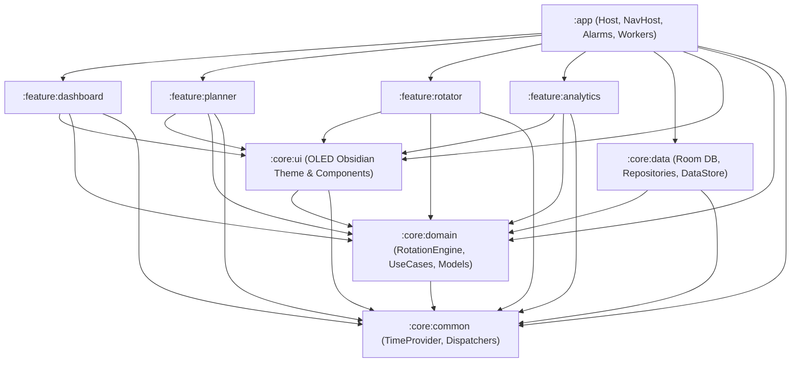

# SubCycler Core Engine & Foundational Architecture Blueprint 🔄🏛️

> **Target File**: `plans/CORE.md`
> **Status**: `Completed` / `Baseline Architecture`
> **Scope**: Core Multi-Module Scaffolding, Pure Kotlin Rotation Engine, Room Persistence, Jetpack Compose Design System & Background Scheduling
> **Target SDK**: Min SDK 26 (Android 8.0) | Target SDK 35 (Android 15) | 100% Kotlin 2.0

---

## 1. Executive Summary & Core Mathematical Thesis

Traditional subscription managers act as passive bill trackers—they notify you *after* money has already left your account. **SubCycler** is built around an active, algorithmic financial thesis:

### The 45-Day Rotation Engine
Standard auto-renewal subscriptions trap users in rigid 30-day billing loops. By introducing a 15-day intentional blackout period between 30-day active binge windows:
$$\text{Billings Per Year} = \frac{365}{\text{Active Days} + \text{Blackout Days}} = \frac{365}{45} \approx 8.11 \text{ billings/year (vs 12)}$$
$$\text{Direct Annual Savings} = \left(1 - \frac{8.11}{12}\right) \times 100\% = 33.33\%$$

### Paired Alternating Swapping
When pairing two complementary streaming services (e.g., Netflix and Disney+) on alternating 30-day active / 30-day blackout cycles:
$$\text{Cost Reduction} = 50.0\% \text{ without experiencing entertainment downtime}$$

---

## 2. Multi-Module Project Topology & SOLID Boundary Rules



### Module Responsibilities:
1. **`:core:common`**: System clock abstractions (`TimeProvider`, `FakeTimeProvider`) and Coroutine dispatchers (`@IoDispatcher`, `@DefaultDispatcher`, `@MainDispatcher`).
2. **`:core:domain`**: Zero Android SDK dependencies (`android.*` forbidden). Houses domain entities (`Subscription`, `CycleStatus`, `PortfolioSummary`), `RotationEngine`, and focused Single-Responsibility Use Cases.
3. **`:core:data`**: Room SQLite persistence (`SubscriptionDao`, `AppDatabase`), `DataStore` preferences, repository implementations, and Hilt DI wiring.
4. **`:core:ui`**: OLED Obsidian Precision design system (`#000000` canvas, `#38BDF8` primary sky, `#6366F1` indigo, `#EF4444` alert), reusable HUDs, bottom sheets, and timeline canvas components.
5. **`:feature:*`**: MVI / UDF Presentation layers (`UiState`, `UiAction`, `*ViewModel`, `*Route`, `*Screen`).
6. **`:app`**: Application entry point, `SubTrackNavHost`, WorkManager background workers (`DailyCycleEvaluationWorker`), and exact Android `AlarmManager` receivers.

---

## 3. Mathematical Rotation Engine Specification (`:core:domain`)

The `RotationEngine` evaluates cycle positions dynamically using calendar date arithmetic:

```kotlin
// Normalized elapsed days calculation
val daysSinceStart = ChronoUnit.DAYS.between(subscription.startDate, today)
val normalizedDays = if (daysSinceStart >= 0) daysSinceStart else 0
val cycleIndex = (normalizedDays / totalCycleDays).toInt()
val dayInCurrentCycle = (normalizedDays % totalCycleDays).toInt()
val isCurrentlyActive = dayInCurrentCycle < activeDays
```

### Action Urgency State Machine:
* **`ActionUrgency.ACTION_DUE`** (Crimson `#EF4444`):
  * Active cycle $\le 3$ days remaining $\rightarrow$ Cancel auto-renew alert.
  * Blackout cycle $\le 1$ day remaining $\rightarrow$ Resubscribe alert.
* **`ActionUrgency.WARNING`** (Amber `#F59E0B`):
  * Active cycle $\le 7$ days remaining $\rightarrow$ Prepare to cancel notice.
  * Blackout cycle $\le 4$ days remaining $\rightarrow$ Blackout ending notice.
* **`ActionUrgency.INFO`** (Sky `#38BDF8` / Zinc `#8E8E93`):
  * Healthy active browsing or blackout savings window.

---

## 4. Local Persistence & Room Schema (`:core:data`)

All data remains 100% offline and local on the user's device:

```kotlin
@Entity(tableName = "subscriptions")
data class SubscriptionEntity(
    @PrimaryKey val id: String,
    val name: String,
    val cost: Double,
    val currency: String = "USD",
    val category: String,
    val billingCycleDays: Int = 30,
    val activeDays: Int = 30,
    val blackoutDays: Int = 15,
    val startDate: Long, // Epoch epochDay
    val renewalDate: Long,
    val strategy: String, // CONTINUOUS, FORTY_FIVE_DAY, SIXTY_DAY, CUSTOM_ROTATION, PAIRED_SWAP
    val isAutoRenewCancelled: Boolean = false,
    val isPaused: Boolean = false,
    val pairedWithSubscriptionId: String? = null,
    val notes: String = "",
    val iconUrl: String? = null,
    val createdAt: Long,
    val updatedAt: Long
)
```

---

## 5. Background Notification & Alarm Scheduling Engine (`:app`)

To guarantee accurate alerts even under aggressive Android Doze Mode:
1. **`AlarmManager.setExactAndAllowWhileIdle`**: Direct system clock triggers on Day 28 (cancel alert) and Day 45 (resubscribe alert).
2. **`DailyCycleEvaluationWorker`**: Periodic 24-hour WorkManager safety net evaluating portfolio status transitions and posting high-priority notifications.
3. **`BootReceiver`**: Automatically reschedules all pending alarms upon device reboot (`ACTION_BOOT_COMPLETED`).

---

## 6. Verification & Testing Matrix

| Layer | Test Suite | Target Invariant |
| :--- | :--- | :--- |
| **Domain** | `RotationEngineTest` | 45-day cycle math yields 33.3% savings; active/blackout dates are exact. |
| **Domain** | `AlignPairedSubscriptionsUseCaseTest` | Paired services alternate seamlessly without overlapping active windows. |
| **Domain** | `GetPortfolioSummaryUseCaseTest` | Multi-subscription cost aggregates match expected compounding totals. |
| **Data** | `SubscriptionMapperTest` | Lossless roundtrip conversion between Entity and Domain model. |
| **Presentation** | `DashboardViewModelTest` | MVI state emissions update correctly upon filter selection or item toggle. |
| **Background** | `DailyCycleEvaluationLogicTest` | Alarm trigger windows fire notifications within configured lead times. |

---

## 7. Baseline Implementation Checklist

- [x] Multi-module Gradle configuration (`settings.gradle.kts`, `build.gradle.kts`).
- [x] Coroutine dispatchers & `TimeProvider` abstraction in `:core:common`.
- [x] `RotationEngine` & Domain use cases in `:core:domain`.
- [x] Room Database, DAO, and Mappers in `:core:data`.
- [x] OLED Obsidian Precision Design System in `:core:ui`.
- [x] Dashboard, Planner, Paired Rotator & Analytics in `:feature:*`.
- [x] Navigation Host, `AlarmManager` scheduler & `WorkManager` in `:app`.
- [x] Comprehensive JVM unit test suite (All passing).
