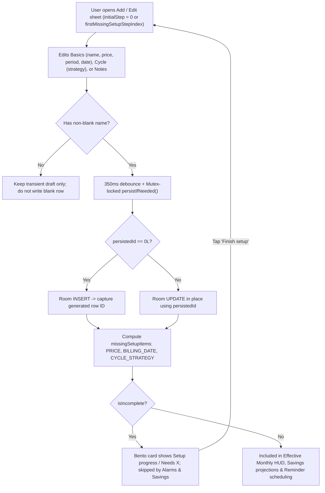
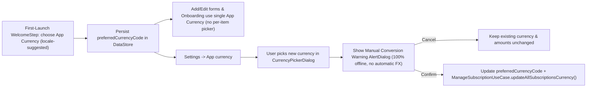

# Feature Specification: Material 3 Expressive Redesign, Auto-Saving Multi-Step UX & Offline Resilience

> **Target File**: `plans/features/MATERIAL_EXPRESSIVE_AND_UX_REVISION_FEATURE.md`
> **Status**: Implemented & Device-Verified (Pixel 4 / Android 13)
> **Target Release**: v1.3.0
> **Platform**: Android 8.0 (API 26) through Android 15 (API 35)
> **Privacy**: 100% offline; zero `android.permission.INTERNET`, zero `USE_EXACT_ALARM`, zero telemetry, zero dynamic wallpaper override

---

## 1. Executive Summary

Following SubCycler's v1.2.0 minimalist refactor and multi-round independent UX/UI audits, v1.3.0 evolves the app from a dark-only prototype into a cohesive, tactile, open-source flagship experience centered on **clarity, zero-friction data entry, and strict offline honesty**:

1. **Botanical Emerald Material 3 Expressive Design System ("Botanical Kinetic Architecture")**:
   - Introduces true edge-to-edge **Adaptive Light & Dark** themes following a **70% Neutral / 30% Botanical Emerald** hierarchy (replacing hardcoded `#000000` dark-only surfaces).
   - Bundles two 100% offline **SIL OFL variable fonts** (`Bricolage Grotesque` + `Plus Jakarta Sans`) and a ~52 KB sculptural fluid silk-waves backdrop (`bg_expressive_silk_waves.jpg`) with zero network fetches.
   - Replaces static chrome with continuous scalloped/organic shape primitives (`ExpressiveCookie12Shape`, `ExpressiveSegmentedGroup`, `CycleRhythmTrack`, `WavyProgressIndicator`), press corner-morphing (`24dp → 15dp`), and spring-driven reactive icons (`AnimatedExpressiveIcons.kt`).
2. **Auto-Saving 3-Step Subscription Form & Progressive Incomplete Status**:
   - Splits the long vertical Add/Edit sheet into 3 compact steps (**Basics**, **Cycle**, **Notes**) with a whisper-quiet neutral capsule switcher.
   - Eliminates manual **Save** buttons entirely: changes auto-save via a debounced, `Mutex`-serialized insert-once-then-update-in-place pipeline and flush immediately on `×`, `Done`, or Back.
   - Blocks accidental swipe-down dismissal (`confirmValueChange = { it != SheetValue.Hidden }`) so half-filled forms are never discarded accidentally.
   - Allows leaving any subscription partially configured in a first-class **Incomplete** state (`Setup · 1/4`, `Needs price`, `Needs date`, `Needs cycle`) that skips premature reminders and savings projections until completed via **Finish setup**.
3. **Single App-Wide Currency Policy**:
   - Captures the user's **App currency** upfront on the first-launch Welcome screen (pre-suggested from device locale) and removes per-subscription currency pickers from Add/Edit forms.
   - Changing **App currency** later in Settings shows an explicit offline warning explaining that SubCycler never fetches exchange rates or converts numeric prices automatically, before unifying all stored subscriptions to the selected currency.
4. **Interactive Cycle Strategy Studio, Kinetic Planner & Editorial Savings**:
   - Replaces static rotation inputs with an interactive **Cycle Strategy Studio** featuring 4 mode pills (`Always`, `Smart`, `Swap`, `Custom`), a spring-animated 90-day rhythm ribbon (`Active` vs `45°` hatched `Break`), and a tactile `0d–45d` break slider with mathematically aligned scale marks.
   - Upgrades **Planner** (now hosting both **Cycle Timeline** and **Paired Swap** after retiring `:feature:rotator`) with duration-proportional hatched timeline blocks, a sliding Date Inspector, and a 60-day interlocking Baton-Pass visualizer.
   - Upgrades **Savings** with a `1Y → 3Y → 5Y` compounding growth curve, stepped horizon progress bars, earned vs. projected ledger tracking, and a per-service **Savings Breakdown** card.
5. **Offline Backup/Restore, Reminder Deduplication & Home Widget**:
   - Adds offline JSON and CSV export/import (`SubscriptionBackupCodec`) directly in Settings.
   - Replaces exact-alarm requirements with inexact `AlarmManager` + `WorkManager` + `ReminderDeduplicator`, preventing duplicate alerts while preserving zero `USE_EXACT_ALARM` permission.
   - Adds a lightweight adaptive Light/Dark home-screen widget (`SubCyclerWidgetProvider`).

---

## 2. Product & Design Decision Log

Every major trade-off made during v1.3.0 is recorded below for contributors and future maintainers:

| Decision | Rationale | Alternative Rejected |
| :--- | :--- | :--- |
| **70/30 Adaptive Light & Dark Botanical Emerald theme (no dynamic wallpaper colors)** | Gives SubCycler an unmistakable, calm editorial identity in both bright daylight and low-light environments without washing the screen in green. | Pitch-black `#000000` OLED-only theme (harsh halation, poor daylight legibility); Android Material You dynamic wallpaper colors (erases brand consistency). |
| **Bundle OFL variable fonts & ~52 KB backdrop offline in `:core:ui/res`** | Enables expressive optical-size typography (`Bricolage Grotesque` + `Plus Jakarta Sans`) and masked hero depth while strictly preserving **zero `android.permission.INTERNET`**. | Google Fonts downloadable font provider (requires network/Play Services and breaks offline-only guarantees). |
| **Automatic saving with zero Save buttons + `Mutex` insert-then-update** | Removes "did I tap Save?" friction in a multi-step flow; once a draft has a non-blank name, edits persist transparently in place without ever creating duplicate rows. | Explicit Save/Draft buttons on every step (adds visual noise and risks silent loss when switching tabs or dismissing). |
| **Block swipe-down dismissal on Add/Edit sheet (`confirmValueChange`)** | Prevents accidental swipe-to-dismiss gestures while scrolling the slider or date picker; users exit intentionally via `×`, `Done`, or system Back. | Default dismissible `ModalBottomSheet` (too easy to close mid-edit on touch screens). |
| **Whisper-quiet neutral capsule step switcher (`Basics · Cycle · Notes`)** | Guides multi-step navigation without competing visually with the active form fields or Cycle Strategy ribbon. | High-contrast full-width step progress bar (felt overly loud and rigid during device testing). |
| **First-class `Incomplete` subscription status instead of blocking form validation** | Users often know a service name before checking exact billing dates or prices. Letting items save as `Incomplete` (`Needs price`, `Needs date`, `Needs cycle`) lowers capture friction while guarding `RotationEngine`, `AlarmScheduler`, and `DailyCycleEvaluationWorker` from emitting bogus savings or reminders. | Hard validation blocking dismissal until every field is filled (causes form abandonment). |
| **Single app-wide currency + explicit offline manual-conversion warning** | Almost all personal subscription budgets are tracked in one primary currency. Removing per-item currency pickers simplifies every form, while the Settings warning keeps offline math honest without fabricating exchange rates. | Per-subscription currency selectors in Add/Edit dialogs (cluttered forms and fragmented totals) or live FX APIs (violates zero `INTERNET` permission). |
| **Remove redundant low-value controls (e.g., `Pause today` button)** | Simplicity is SubCycler's primary virtue. Overlapping manual overrides created cognitive ambiguity next to Billing/Cancel toggles and Cycle Strategy controls. | Keeping every power-user shortcut visible in the primary detail bottom sheet. |
| **Merge `:feature:rotator` into `:feature:planner` (3-tab split floating toolbar)** | Cycle Timeline and Paired Swap answer the same mental question ("when are my services active?"). Consolidating into 3 tabs (`Subscriptions`, `Planner`, `Savings`) pairs cleanly with the detached scalloped `+` button. | 4-tab fixed bottom navigation bar (cramped labels and redundant scheduling destinations). |
| **Inexact `AlarmManager` + `WorkManager` safety net + `ReminderDeduplicator`** | Eliminates `USE_EXACT_ALARM` / Play policy friction while keeping daily renewal and break reminders reliable and deduplicated per `(subscriptionId, phase, date)`. | Exact alarms requiring privileged manifest permissions. |
| **Use `isBillingDateConfirmed` & `isStrategyConfirmed` DB flags (Room v3–v5)** | Tracks whether dates and strategies were explicitly confirmed by the user without polluting human-readable `notes` text; legacy onboarding placeholder notes are migrated cleanly. | Parsing magic sentinel strings out of the `notes` column. |

---

## 3. Core Flows & State Machines

### 3.1 Auto-Saving Multi-Step Form & Progressive Incomplete Lifecycle

### 3.2 Single App-Wide Currency & Offline Conversion Policy

---

## 4. Database Schema Evolution (`Room v1 → v5`)

All migrations preserve user data in place without destructive fallback (`AppDatabase.kt`):

| Migration | Column(s) Added / Updated | Purpose |
| :--- | :--- | :--- |
| **`MIGRATION_1_2`** | `billingPeriod TEXT NOT NULL DEFAULT 'MONTHLY'` | Supports `MONTHLY` vs. `YEARLY` billing cadences with normalized monthly/annual portfolio math. |
| **`MIGRATION_2_3`** | `isBillingDateConfirmed`, `cancelledCycleIndex`, `completedBreaksCount`, `earnedSavingsTotal` + cleans legacy onboarding unconfirmed note | Tracks confirmed billing anchors and realized earned savings ledger across completed breaks. |
| **`MIGRATION_3_4`** | `bonusActiveDays INTEGER NOT NULL DEFAULT 0` | Supports extending an active cycle ("Skip upcoming break") without corrupting base cadence math. |
| **`MIGRATION_4_5`** | `isStrategyConfirmed INTEGER NOT NULL DEFAULT 1` | Distinguishes pre-existing/confirmed subscriptions (`1`) from newly created drafts whose Cycle step has not yet been confirmed (`0`). |

---

## 5. Architecture & Code Integration

| Module / File | Responsibility |
| :--- | :--- |
| `core/domain/.../model/Subscription.kt` | `BillingPeriod`, `SetupMissingItem`, `isBillingDateConfirmed`, `isStrategyConfirmed`, `missingSetupItems`, `isIncomplete`, `setupCompletionFraction`, `firstMissingSetupStepIndex`, and earned-savings fields. |
| `core/domain/.../engine/RotationEngine.kt` | Normalized monthly/yearly billing math, `bonusActiveDays` cycle extension, `isIncomplete` guards, and accurate multi-year compounding ROI. |
| `core/domain/.../model/RegionalPriceCatalog.kt` | Offline curated local tier prices across 8 currencies (`USD`, `JPY`, `EUR`, `GBP`, `CAD`, `AUD`, `INR`, `KRW`) with zero fabricated FX conversion. |
| `core/domain/.../backup/SubscriptionBackupCodec.kt` | Deterministic offline JSON & CSV serialization/deserialization for portfolio backup and restore. |
| `core/domain/.../usecase/ManageSubscriptionUseCase.kt` | CRUD, `completeSubscriptionAction`, `skipNextBreak`, `logCompletedBreak`, `updateAllSubscriptionsCurrency`, and reminder rescheduling hooks. |
| `core/data/.../local/AppDatabase.kt` & `SubscriptionEntity.kt` | Room v5 database, `MIGRATION_1_2`..`MIGRATION_4_5`, and entity/mapper support. |
| `core/data/.../preferences/UserPreferencesRepositoryImpl.kt` | Persists `preferredCurrencyCode`, `themeMode` (`SYSTEM`/`LIGHT`/`DARK`), `reminderLeadDays`, `isOnboardingCompleted`, calendar settings, and `PendingSubscriptionAction`. |
| `core/ui/.../theme/Color.kt`, `Theme.kt`, `Type.kt` | Adaptive 70/30 Botanical Emerald Light & Dark palettes and bundled OFL variable typography (`Bricolage Grotesque` + `Plus Jakarta Sans`). |
| `core/ui/.../components/ExpressiveShapes.kt`, `ExpressiveBackdrop.kt`, `ExpressiveTypography.kt`, `AnimatedExpressiveIcons.kt` | Scalloped cookie/organic shapes, `ExpressiveSegmentedGroup`, `CycleRhythmTrack`, `WavyProgressIndicator`, diagonal rest-hatch modifier, masked silk-waves backdrop, `ExpressiveMoneyText`, and spring icons. |
| `core/ui/.../components/AddEditSubscriptionDialog.kt` & `InteractiveCycleStrategyPicker.kt` | Auto-saving 3-step swipe-locked sheet, whisper-quiet capsule step switcher, `Not sure` date toggle, and interactive 90-day Cycle Strategy Studio. |
| `core/ui/.../components/FinancialEfficiencyHud.kt`, `SubscriptionGridItem.kt`, `SubscriptionDetailBottomSheet.kt` | Masked hero card with embossed scalloped savings stamp & spend proportion bar, 2-column Bento cards with press corner-morph + `CycleRhythmTrack`, and streamlined Detail sheet (`Finish setup` flow for Incomplete items). |
| `core/ui/.../components/CalendarAwarenessComponents.kt` & `CurrencyPickerDialog.kt` | Consolidated offline Settings sheet: Appearance (`System`/`Light`/`Dark`), `App currency` + manual-conversion warning dialog, Reminder timing, Optional Calendar Awareness, and JSON/CSV Backup & Restore. |
| `feature/dashboard/**` | Wires `saveSubscription` (returns persisted `Long` ID for race-free auto-save), currency unification, Incomplete filtering, undo delete, and backup/restore triggers. |
| `feature/onboarding/**` | Expressive 4-step first-launch flow with upfront **App currency** selection on `WelcomeStep` and regional 1-tap tier chips. |
| `feature/planner/**` & `core/ui/.../CycleTimelineView.kt` | Unified `Cycle Timeline` + `Paired Swap` screen with proportional hatched timeline blocks, sliding Date Inspector, and 60-day Baton-Pass visualizer (replacing retired `:feature:rotator`). |
| `feature/analytics/**` | Editorial Savings screen with `1Y → 3Y → 5Y` compounding growth curve, stepped horizon bars, per-service `SAVINGS BREAKDOWN`, and `Try Paired Swap →` shortcut. |
| `app/.../ui/navigation/SubTrackNavHost.kt` | Split floating pill toolbar across 3 tabs (`Subscriptions`, `Planner`, `Savings`) + detached 12-petal scalloped `+` button with soft radial shadow and bottom scrim. |
| `app/.../notification/**` & `app/.../widget/SubCyclerWidgetProvider.kt` | `ReminderDeduplicator`, `AndroidSubscriptionReminderScheduler`, `AndroidSubscriptionActionNotifier`, `SubscriptionActionReceiver`, and adaptive Light/Dark home-screen widget. |

---

## 6. Verification & Test Coverage

- **JVM Unit Tests (`.\gradlew.bat testDebugUnitTest`)**:
  - `RotationEngineTest`: Monthly/yearly normalization, `bonusActiveDays`, incomplete subscription exclusions, and compounding savings math.
  - `ManageSubscriptionUseCaseTest`: Subscribe/unsubscribe transitions, `updateAllSubscriptionsCurrency` atomic unification, and reminder scheduling hooks.
  - `SubscriptionBackupCodecTest`: JSON & CSV round-trip fidelity, escaping, malformed payload rejection, and schema compatibility.
  - `RegionalPriceCatalogTest`: Regional currency tier coverage and absence of fabricated FX fallback.
  - `ExpressiveTypographyTest`: Locale-safe `ExpressiveMoneyText` token splitting across prefix/suffix currencies and zero-decimal currencies (`JPY`, `KRW`).
  - `DashboardViewModelTest` & `OnboardingViewModelTest`: Auto-save persistence, incomplete tracking, single app currency flow, pending action recovery, and onboarding import.
- **On-Device Android Instrumentation & Visual QA (Pixel 4 / Android 13 / API 33)**:
  - Full instrumentation suite (`CalendarAwarenessComponentsTest`, `CancellationLinkLauncherTest`, `CancellationOptionsDialogTest`) passed on device: **`OK (13 tests)`**.
  - Verified `CalendarAwarenessComponentsTest.changingCurrencyInSettingsShowsManualConversionWarningBeforeApplying` ensures changing `App currency` displays the offline manual-conversion warning before updating currency preferences.
  - Verified `CancellationOptionsDialogTest` enforces zero `android.permission.INTERNET` and zero `USE_EXACT_ALARM` in the merged manifest.
  - Visually audited across Light and Dark modes on Home, Add/Edit 3-step auto-save sheet, Detail sheet (Active & Incomplete states), Planner Timeline & Paired Swap, Savings Breakdown, Onboarding Welcome, and Settings.
