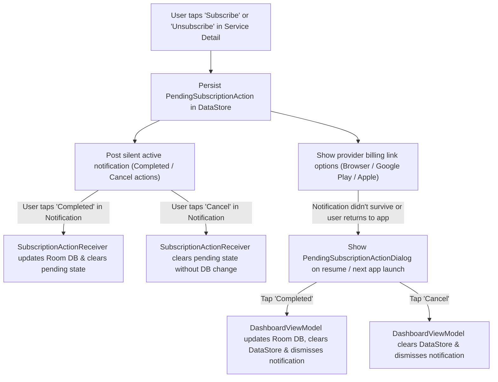

# Feature Specification: Minimal Home UX & Assisted Subscribe / Unsubscribe Progress Notification

> **Target File**: `plans/features/MINIMAL_UX_AND_ACTION_NOTIFICATION_FEATURE.md`
> **Status**: Implemented
> **Target Release**: v1.2.0
> **Platform**: Android 8.0 (API 26) through Android 15 (API 35)
> **Privacy**: 100% offline; zero `android.permission.INTERNET`, zero ads, zero telemetry, non-interruptive notifications

---

## 1. Executive Summary

To make SubCycler as effortless, fast, and privacy-respecting as possible, this specification introduces two core product refinements:

1. **Minimalist Home Screen & 3-Tab Navigation**:
   - Declutters the Home Screen (`DashboardScreen`) so only high-signal elements remain visible on the pitch-black OLED canvas (`#000000`).
   - Removes AI/Agentic branding (`"AGENTIC 45d"` badge), removes the `"App Drawer / N services"` section header, simplifies the top Financial HUD to **Monthly Active** spend and **Saved / Yr**, removes the `2dp` mini progress bars inside 3-column grid tiles, and hides filter chips when the user tracks fewer than 5 services.
   - Consolidates the Bottom Navigation Bar from 4 tabs into 3 focused tabs (`Subscriptions`, `Planner`, `Savings`), merging Paired Swap into the `Planner` screen.
2. **Assisted Subscribe & Unsubscribe Active Notification + Persistent Launch Recovery**:
   - Replaces the postponed AI agent cancellation path with a lightweight, human-in-control workflow that requires zero internet permission.
   - When the user clicks **Subscribe** or **Unsubscribe** on any service, SubCycler persists a `PendingSubscriptionAction` in local DataStore, posts a silent, non-interruptive active notification (`IMPORTANCE_LOW`) with **Completed** and **Cancel** action buttons, and presents official provider/store billing links.
   - If the notification does not survive (dismissed, blocked, OS-killed, or device rebooted) or the user returns to the app before tapping a notification action, SubCycler reads the persisted `PendingSubscriptionAction` and presents a one-tap **Completed / Cancel** recovery popup (`PendingSubscriptionActionDialog`).

---

## 2. User Flow & State Machine

### State Update Semantics on `Completed`

| Action Type | Subscription Mutation | Rationale |
| :--- | :--- | :--- |
| **`UNSUBSCRIBE`** | `isAutoRenewCancelled = true` (`startDate` unchanged) | Paid access remains active through the end of the current cycle, then transitions into blackout. |
| **`SUBSCRIBE`** | `startDate = today`, `isAutoRenewCancelled = false` | Starts a fresh active billing cycle anchored to today with auto-renewal active. |

---

## 3. Architecture & Code Integration

| File | Responsibility |
| :--- | :--- |
| `core/domain/.../model/PendingSubscriptionAction.kt` | Pure Kotlin `SubscriptionActionProgressType` (`SUBSCRIBE`, `UNSUBSCRIBE`) and `PendingSubscriptionAction` model. |
| `core/domain/.../repository/SubscriptionActionNotifier.kt` | Domain abstraction for posting and dismissing the active progress notification. |
| `core/domain/.../usecase/ManageSubscriptionUseCase.kt` | `completeSubscriptionAction(subscriptionId, actionType, today)` applying deterministic subscribe/unsubscribe state transitions. |
| `core/data/.../preferences/UserPreferencesRepositoryImpl.kt` | Persists and clears `PendingSubscriptionAction` keys atomically in DataStore. |
| `core/ui/.../components/PendingSubscriptionActionDialog.kt` | Minimal OLED recovery popup shown on resume or next app launch when an action remains pending. |
| `core/ui/.../components/FinancialEfficiencyHud.kt` | Minimal borderless header showing only `MONTHLY ACTIVE` and `SAVED / YR`. |
| `core/ui/.../components/SubscriptionGridItem.kt` | Decluttered 3-column grid tile without internal progress bars. |
| `feature/dashboard/.../DashboardViewModel.kt` | Coordinates `StartSubscriptionActionProgress` and `ResolvePendingSubscriptionAction` across DataStore, Room, and `SubscriptionActionNotifier`. |
| `feature/dashboard/.../DashboardScreen.kt` | Minimal Home layout, lifecycle observer closing link chooser on background (`ON_STOP`), and recovery dialog rendering. |
| `feature/planner/.../PlannerScreen.kt` & `PlannerViewModel.kt` | Hosts both `Cycle Timeline` and `Paired Swap` inside the consolidated `Planner` tab. |
| `app/.../notification/NotificationHelper.kt` | Dedicated `IMPORTANCE_LOW` silent progress channel (`subtrack_action_progress_channel`) with `Completed` and `Cancel` action buttons. |
| `app/.../receiver/SubscriptionActionReceiver.kt` | `@AndroidEntryPoint` `BroadcastReceiver` handling notification `Completed` and `Cancel` actions asynchronously. |

---

## 4. Verification & Test Coverage

- **`ManageSubscriptionUseCaseTest`**:
  - Verifies `completeSubscriptionAction` for `UNSUBSCRIBE` marks `isAutoRenewCancelled = true` while preserving `startDate`.
  - Verifies `completeSubscriptionAction` for `SUBSCRIBE` resets `startDate = today` and `isAutoRenewCancelled = false`.
- **`DashboardViewModelTest`**:
  - Verifies starting an action persists `PendingSubscriptionAction` and notifies `SubscriptionActionNotifier`.
  - Verifies completing or cancelling an action updates Room accordingly, clears DataStore persistence, and dismisses the active notification.
  - Verifies a persisted pending action survives across sessions for the next-launch recovery popup.
- **`CancellationOptionsDialogTest` (Android Instrumentation)**:
  - Verifies `PendingSubscriptionActionDialog` displays and triggers `Completed` and `Cancel` callbacks.
  - Verifies `AndroidManifest.xml` does not request `android.permission.INTERNET`.
